# Module 06 – Modal Analysis

## Learning Objectives

In this module, the following topics and competencies are addressed:

* Significance of natural frequencies and mode shapes for components and assemblies
* Derivation of fundamental relationships using simple mass spring systems
* Influence of boundary conditions and mass distribution on natural vibration behaviour
* Implementation of a modal analysis in ANSYS Mechanical
* Interpretation and evaluation of mode shapes
* Transfer to more complex assemblies with rigid and deformable parts

## Motivation and Key Questions

Vibrations occur in technical systems in many different forms. Even simple observations show that structures do not vibrate arbitrarily, but instead develop characteristic, system specific patterns. These patterns do not arise by chance, but correspond to the natural vibration behaviour of the respective system.  

The following video sequences illustrate typical situations in which this natural behaviour can be directly observed. The examples range from everyday objects to technical machining processes and serve as a starting point for analysing the underlying mechanisms.

### Vibration of a Street Lamp

<!-- markdownlint-disable MD033 -->
<video controls width="700">
  <source src="/fem-course/media/08_modalanalyse/lampe.mp4" type="video/mp4">
  Your browser does not support this video.
</video>
<!-- markdownlint-enable MD033 -->

??? question "What can be observed in this video sequence?"

    * The lamp undergoes free vibration.  
    * The motion is concentrated in a characteristic shape that corresponds to a mode shape of the system.  
    * The reason the lamp vibrates in this form is that the wind contains excitation components that coincide with the natural frequency of the system.

---

### Vibration of a Tabletop

<!-- markdownlint-disable MD033 -->
<video controls width="700">
  <source src="/fem-course/media/08_modalanalyse/tisch.mp4" type="video/mp4">
  Your browser does not support this video.
</video>

??? question "Which phenomena can be observed here?"

    * The tabletop is apparently mounted very weak within the frame; even small forces can lead to a twisting motion of the entire structure.  
    * After being released, the tabletop undergoes free vibration, indicating a combination of low stiffness of the supporting frame and relatively high mass of the tabletop.  
    * Such a configuration is structurally unfavourable from a dynamics perspective: low frame stiffness combined with a large tabletop mass leads to pronounced natural vibration behaviour.  

---

### Aeroelastic Instability of the Tacoma Narrows Bridge

<!-- markdownlint-disable MD033 -->
<iframe  
    width="700"  
    height="394"  
    src="https://www.youtube-nocookie.com/embed/XggxeuFDaDU?cc_load_policy=0&cc_lang_pref=en&hl=en"  
    title="Tacoma Narrows Bridge Collapse"
    frameborder="0"  
    allow="accelerometer; autoplay; clipboard-write; encrypted-media; gyroscope; picture-in-picture"  
    allowfullscreen
    playsinline>
</iframe>
<!-- markdownlint-enable MD033 -->

??? question "Which structural dynamic effects are visible?"

    * The bridge exhibits pronounced torsional oscillations with rapidly increasing amplitude.
    * Natural frequencies and mode shapes characterise the vibrating structure and provide a basis for its aeroelastic assessment.
    * During aeroelastic flutter, the motion of the bridge deck changes the aerodynamic forces. These act back on the motion and can supply more energy than is dissipated by damping.
    * This self-excitation differs from forced resonance caused by a prescribed periodic external force. Such a forcing frequency need not coincide with a natural frequency here.
    * A purely structural modal analysis describes mode shapes and natural frequencies but is insufficient to assess aeroelastic stability [@WSDOTTacomaFailure].

---

### Vibrations During Milling

<!-- markdownlint-disable MD033 -->
<iframe  
    width="700"  
    height="394"  
    src="https://www.youtube-nocookie.com/embed/__yQcF4G7tM?start=37&end=105&cc_load_policy=0&cc_lang_pref=en&hl=en"  
    title="Machining vibration example"
    frameborder="0"  
    allow="accelerometer; autoplay; clipboard-write; encrypted-media; gyroscope; picture-in-picture"  
    allowfullscreen
    playsinline>
</iframe>
<!-- markdownlint-enable MD033 -->

??? question "Which indications of natural frequencies does this machining process provide?"

    * The tool starts to vibrate as soon as the cutting conditions create a dynamically unstable configuration. This occurs when the feedback between tool motion and chip formation amplifies vibrations rather than damping them.  
    * The resulting chatter marks are a direct imprint of the tool vibration and reveal the dominant mode shape of the system.  
    * The overall system consisting of tool, spindle, and workpiece exhibits one or more characteristic natural frequencies, near which the vibration behaviour becomes particularly pronounced.  
    * Dynamic instability arises when the process excitation contains components in the range of a natural frequency and the system damping is insufficient to reduce the vibration.  
    * In the video sequence, active vibration reduction is visible. Its effect is reflected in a temporary and significant reduction of vibration amplitude, as the damper actively extracts energy from the system and thereby influences the natural vibration behaviour.  

---

### Vibrations of a Machine Base

<!-- markdownlint-disable MD033 -->
<video controls width="700">
  <source src="/fem-course/media/08_modalanalyse/unterbau.mp4" type="video/mp4">
  Your browser does not support video playback.
</video>
<!-- markdownlint-enable MD033 -->

??? question "Which structural dynamic aspects become apparent here?"

    * The video shows a compilation of numerous mode shapes of a machine base, as calculated in a FEM modal analysis.  
    * The displayed modes cover a wide frequency range and illustrate that technical systems possess many characteristic mode shapes, which may develop locally or globally.  
    * The visible vibration patterns are governed by the distribution of mass and stiffness.
    * Low frequency mode shapes often involve the entire structure, whereas higher frequency modes exhibit locally concentrated deformations.  
    * The large number of possible mode shapes explains why even small excitations, such as those in the preceding milling process video, can activate specific modes and thereby cause undesired vibrations.  

---

### Interim Conclusion

The presented examples clearly demonstrate that technical systems do not vibrate arbitrarily, but instead exhibit pronounced mode shapes that occur within characteristic frequency ranges.  

These observations lead to fundamental questions:

* Which properties of a system determine its vibration behaviour?  
* Why do vibrations become amplified only within certain frequency ranges?  
* Which physical parameters govern the location and shape of the mode shapes?  
* How do mode shapes influence the behaviour of complex components and assemblies?
* How do single degree of freedom systems differ from continuous structures?  

For a systematic analysis of these questions, the approach progresses step by step from simple dynamic models to complex technical components. The starting point is the single mass oscillator, followed by the investigation of beams, plates, shafts, and assemblies.

---

## Theoretical Background

### Basic Concepts

Technical vibrations can be described using a small number of fundamental quantities.  

[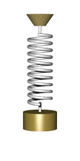{width=100px}](media/08_modalanalyse/Animated-mass-spring.gif "Mass spring animation"){.glightbox}
Image source[@wikipedia2025]

* **Displacement**  
  Time dependent deviation of a quantity (e.g. position) from the equilibrium state.  

* **Period** \(T\)  
  Time interval after which a periodic process repeats itself.  

* **Frequency** \(f\) and **angular frequency** \(\omega\)  
  \(f = \frac{1}{T}\)  
  \(\omega = 2 \pi f\)  

* **Amplitude** \(A\)  
  Maximum displacement from equilibrium.  

These quantities form the basis for the description of mechanical vibrations.  

---

### Undamped Vibration of a Single Mass Oscillator

A wide range of technical vibration problems can essentially be reduced to the linear mass spring system.

[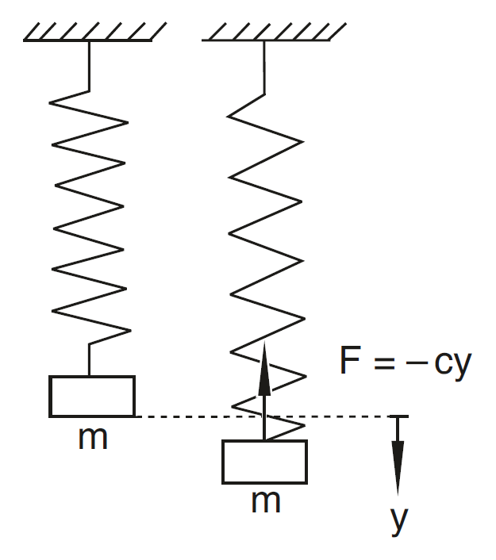{width=300px}](media/08_modalanalyse/feder_masse.png "Mass spring system"){.glightbox}
Image source[@Eichler2023]  

The displacement from the equilibrium position is described by \(y(t)\). The restoring force is proportional to the displacement, but acts in the opposite direction:

\[
F = -\,c\,y(t)
\]

The quantity \(c\) is the spring constant (unit: N/m or N/mm).

#### Force Balance and Equation of Motion

According to Newton’s second law, the resultant force leads to an acceleration:

\[
F = m\,\ddot{y}(t)
\]

Equating both expressions yields:

\[
m\,\ddot{y}(t) = -\,c\,y(t)
\]

or, in standard form:

\[
\ddot{y}(t) + \frac{c}{m}\,y(t) = 0
\]

This is a **linear, homogeneous second order differential equation** with constant coefficients.

---

#### Harmonic Solution Ansatz

A solution of the form

\[
y(t) = \hat{y}\,\cos(\omega_0 t + \varphi_0)
\]

is assumed. The derivatives are:

\[
\dot{y}(t) = -\,\hat{y}\,\omega_0 \sin(\omega_0 t + \varphi_0)
\]

\[
\ddot{y}(t) = -\,\hat{y}\,\omega_0^{2} \cos(\omega_0 t + \varphi_0)
\]

Substitution into the equation of motion leads to:

\[
-\,\hat{y}\,\omega_0^{2} \cos(\omega_0 t + \varphi_0) + \frac{c}{m}\,\hat{y}\,\cos(\omega_0 t + \varphi_0) = 0
\]

This results in the characteristic relation:

\[
\omega_0^{2} = \frac{c}{m}
\qquad\Longrightarrow\qquad
\omega_0 = \sqrt{\frac{c}{m}}
\]

This is the **natural angular frequency** of the system.

---

#### Natural Frequency and Period of Oscillation

From the angular frequency, the natural frequency is obtained as:

\[
f_0 = \frac{\omega_0}{2\pi}
\]

The corresponding period is:

\[
T_0 = \frac{1}{f_0} = \frac{2\pi}{\omega_0}
\]

The oscillation is therefore a **system property**, determined exclusively by the mass and the spring constant. The initial conditions influence only the amplitude \(\hat{y}\) and the phase \(\varphi_0\).

#### Representation of the Oscillation in the Time and Frequency Domains

The properties of the solution of the single mass oscillator can be illustrated clearly in both the time domain and the frequency domain. In the time domain, the displacement \(y(t)\), amplitude \(\hat{y}\), period \(T_0\), and initial phase \(\varphi_0\) become visible. In the frequency domain, ideally only a single frequency component appears at the natural frequency \(f_0\) or \(\omega_0\).  

**Time domain:** Harmonic oscillation with marked characteristic quantities  

[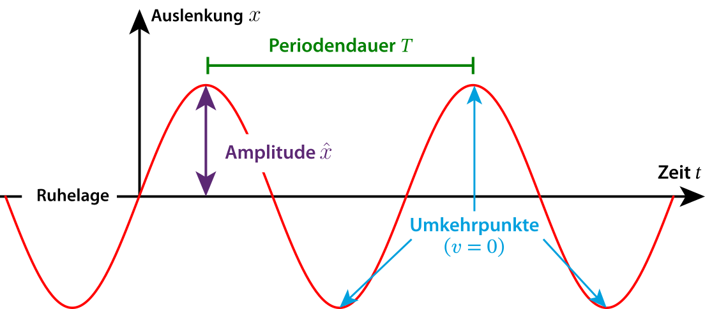{width=500px}](media/08_modalanalyse/harmonische_schwingung_zeitbereich.svg "Harmonic oscillation (time domain)"){.glightbox}
Image source[@kitmath2025]

This representation shows how amplitude, period, and initial phase determine the shape of the time function.

**Frequency domain:** Representation of the natural frequency

[{width=500px}](media/08_modalanalyse/harmonische_schwingung_frequenzbereich.svg "Harmonic oscillation (frequency domain)"){.glightbox}
Image source[@physikbuch2025]

The corresponding spectrum ideally shows only a single frequency component at the natural frequency.

---

### Damped Oscillation

Real technical systems lose vibrational energy due to friction, air resistance, or material damping. With viscous damping, the damping force is proportional to the velocity:

\[
m \ddot{x} + d \dot{x} + c x = 0
\]

Here, \(m\) is the mass in \(\mathrm{kg}\), \(d\) the damping coefficient in \(\mathrm{N\,s/m}\) and \(c\) the spring stiffness in \(\mathrm{N/m}\). As before, \(\omega_0=\sqrt{c/m}\).

The following cases are distinguished:  

* underdamping (decaying oscillation)
* critical damping (limiting case, fastest decay without oscillation)  
* overdamping (no periodic motion)

For the underdamped case \(0<d<2\sqrt{mc}\), the damped natural angular frequency is given by:

\[
\omega_\mathrm{d} = \sqrt{\omega_0^2 - \left(\frac{d}{2m}\right)^2}
\]

[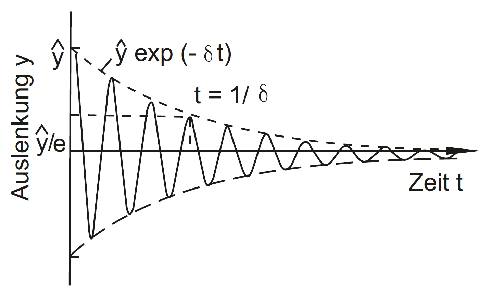{width=350px}](media/08_modalanalyse/gedaempfte_schwingung.png "Damped oscillations"){.glightbox}

The axes show displacement \(y\) (German: “Auslenkung”) against time \(t\) (“Zeit”).

Image source[@Eichler2023]  

---

### Forced Oscillation and Resonance

If a time dependent external force acts on the system  

\[
F(t) = F_0 \sin(\omega t)
\]

the free vibration component decays in the presence of viscous damping. After the transient response has decayed, a steady-state oscillation remains at the excitation frequency \(\omega\). For a constant force amplitude \(F_0\), its amplitude depends on the excitation frequency and damping. With weak damping, the amplitude maximum lies close to the undamped natural angular frequency \(\omega_0\). This amplitude amplification is referred to as resonance. Without damping, the amplitude grows without bound at \(\omega=\omega_0\) in the idealised model; no finite steady state is established [@XueDampedDriven].

The graph illustrates the **unbalance response of an idealised rotor**. Here, \(n\) is the rotational speed, \(n_\mathrm{k}\) the critical speed, \(X\) the displacement amplitude and \(e\) the mass eccentricity. The curve applies to an undamped single-mass model: no finite steady-state amplitude exists at \(n=n_\mathrm{k}\). The hatched region is schematic and does not define general speed limits [@NPTELUnbalance].

[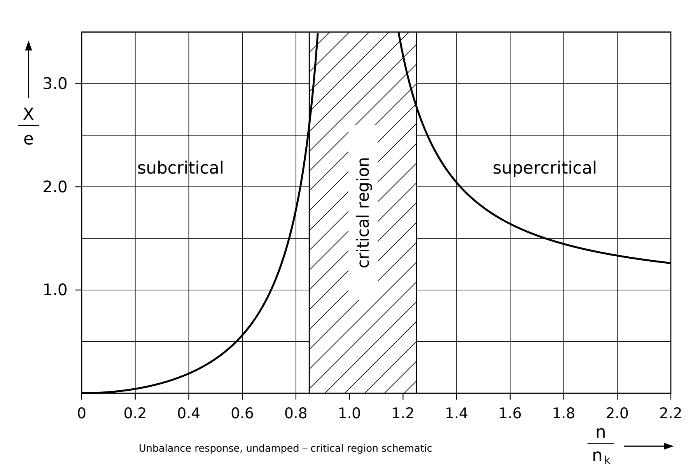{width=900px}](media/08_modalanalyse/resonanz_unwucht.en.png "Unbalance response with subcritical and supercritical regions"){.glightbox}

---

### Superposition and Beating

A technical system can contain several vibration components simultaneously. The superposition of two harmonic oscillations with slightly different frequencies leads to beating, an alternating amplification and attenuation of the overall amplitude.  

The superposition of two oscillations can be written as:  

\[
x(t) = A_1 \sin(\omega_1 t) + A_2 \sin(\omega_2 t)
\]

The beat frequency is given by:  

\[
f_\mathrm{s} = \lvert f_1 - f_2 \rvert
\]

This concept therefore forms the transition to the idea of a multitude of mode shapes in real structures.  

[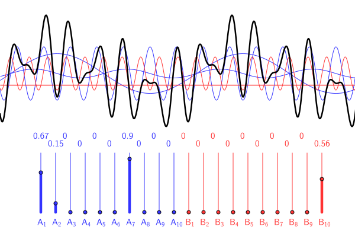{width=650px}](media/08_modalanalyse/ueberlagerung.svg "Superposition of oscillations"){.glightbox}
Image source[@physikbuch2025].  

---

### From One Dimensional Vibration to Modal Analysis

Natural vibrations do not occur only in one dimensional systems, but wherever continua such as air columns, strings, beams, membranes, or plates exhibit oscillatory behaviour. These examples make it clear that:

* real structures possess a large number of natural frequencies  
* each natural frequency is associated with a characteristic mode shape  
* only certain frequencies are compatible with the geometry and boundary conditions and lead to pronounced vibration behaviour  

These principles can be transferred to discretised engineering structures. For a linear system with constant mass, damping and stiffness matrices:

\[
M\ddot{u}(t)+C\dot{u}(t)+Ku(t)=p(t)
\]

Here, \(u(t)\) is the displacement vector, \(p(t)\) the external load vector, and \(M\), \(C\) and \(K\) are the mass, damping and stiffness matrices. For free, undamped vibrations, \(p(t)=0\) and \(C=0\). Substitution of \(u(t)=\Phi\,\mathrm{e}^{\mathrm{i}\omega t}\) gives:

\[
K\Phi=\omega^2 M\Phi
\]

The eigenvalues \(\omega_i^2\) yield the natural angular frequencies; \(f_i=\omega_i/(2\pi)\) are the natural frequencies in Hz. The eigenvectors \(\Phi_i\) describe the mode shapes. This undamped modal analysis does not determine damping ratios [@AnsysModalTheory].

### Model Levels

The model depends on the motion of interest: a rigid body represents global motion, while a system of discrete masses represents relative motions between those masses. Continuous beams or plates have spatially distributed deformations. An FE model approximates these using a finite number of nodal degrees of freedom. More degrees of freedom alone do not guarantee a better model; materials, supports and connections must suit the question being investigated.

[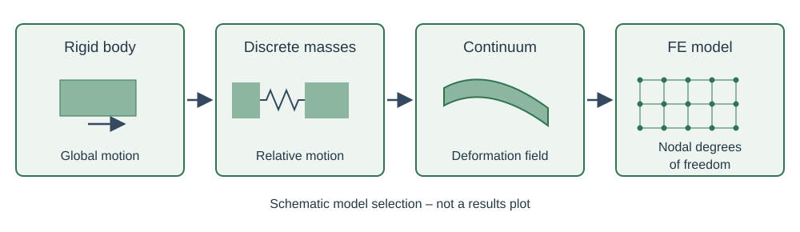{width=900px}](media/08_modalanalyse/modellstufen.en.svg "Model levels and FE discretisation"){.glightbox}

!!! info "Further Reading"
    Beitelschmidt/Dresig, *Maschinendynamik*, chapters “Modellbildung und Kennwertermittlung” and “Lineare Systeme mit mehreren Freiheitsgraden: Modellbildung und freie Schwingungen” [@Beitelschmidt2024].

## Task Definition: Beam

Use [biegebalken.stp](media/08_modalanalyse/biegebalken.stp). The beam has a rectangular cross-section with \(b=8\,\mathrm{mm}\), \(h=12\,\mathrm{mm}\) and a length of \(L=100\,\mathrm{mm}\). Check the imported dimensions.

Create a **new material** named *Aluminium_Modal*. Use \(\rho=2.7\,\mathrm{kg/dm^3}\), \(E=70\,\mathrm{GPa}\) and \(\nu=0.35\). Defining the material properties yourself is part of this task.

1. Calculate the first **ten mode shapes** for each case: free at both ends, fixed at one end and fixed at both ends.
2. Identify rigid body and elastic modes. Compare corresponding mode shapes and discuss the influence of the constraints.
3. Change the material of the beam fixed at both ends to *Structural Steel* and compare the results.

### Analytical Solutions of Simple Structures

For a simple beam, bending natural frequencies can also be estimated without an FE model. The beam is treated as slender and uniform: it bends, while additional deformation due to shear is neglected. This simplified model is called an Euler–Bernoulli beam. The following formula applies to a cantilever beam with small deformations; rotary inertia is also neglected [@TUGrazCantilever].

\[
f_n=\frac{\beta_n^2}{2\pi L^2}\sqrt{\frac{EI}{\rho A}},
\qquad \beta_1\approx1.875,\quad\beta_2\approx4.694
\]

Here, \(L\) is the free length, \(E\) Young’s modulus, \(I\) the second moment of area for the bending direction considered, \(\rho\) the density and \(A\) the cross-sectional area. Using \(E\) in Pa, \(I\) in m⁴, \(\rho\) in kg/m³, \(A\) in m² and \(L\) in m gives \(f_n\) in Hz.

For a rectangular cross-section, use the appropriate second moment of area for each bending direction. Compare corresponding **bending modes**, rather than simply the first and second rows of the FE results list. Torsional and longitudinal modes are not covered by this formula. For short beams and higher modes, the beam assumptions can differ appreciably from a 3D model.

??? note "Which numerical values apply?"

    The values 1.875 and 4.694 belong to the first and second bending modes of a uniform cantilever beam in this model. They are not restricted to one beam length or one rectangular cross-section: length, cross-section and material are accounted for separately in the formula. Other support conditions require different values [@TUGrazCantilever].

## Implementation in ANSYS – Beam

The guide explains modelling and evaluation using the beam. Investigate the support and material variants according to the task definition.

### 1. Project Management and Geometry Import

Select the *Modal* analysis system in Workbench and import the beam geometry. A standalone modal analysis is sufficient for this introduction. Linking to *Static Structural* can be used subsequently to account for a pre-stressed state.

<!-- SCREENSHOT: 01_modal_projektoberflaeche.en.png
Show Workbench with a standalone Modal system and its project cells in English.
The existing English capture from Peer Teaching B1 / Add_Modal_into_project.png is suitable
for this model-neutral view. Keep the filename when updating the capture.
-->

[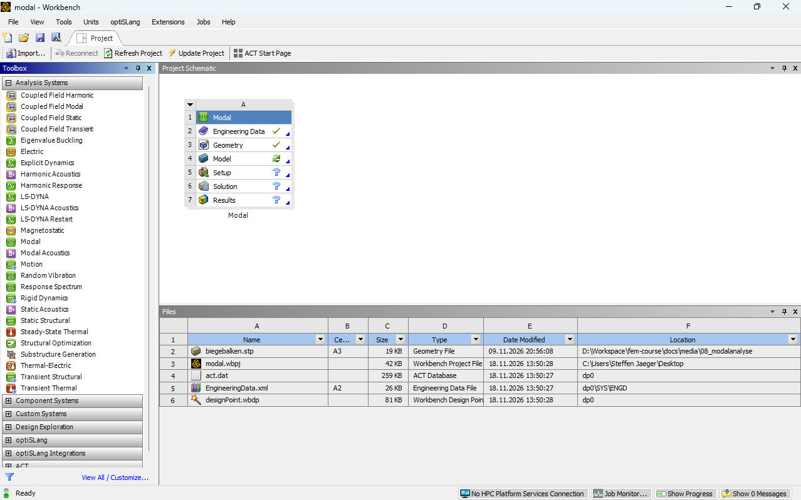{width=650px}](media/08_modalanalyse/01_modal_projektoberflaeche.en.png "Project schematic modal analysis"){.glightbox}

### 2. Material and Mesh

1. Open *Engineering Data* in Workbench. At the bottom of the material overview, click the row *Click here to add a new material*. Enter the name *Aluminium_Modal* there to create the new material.

    <!-- SCREENSHOT: 02a_material_hier_klicken.en.png
    In Engineering Data, show the row for adding a new material.
    Mark "Click here to add a new material" with an arrow.
    Capture a readable material overview and row, preferably before entering the material name.
    Replace this PNG directly; keep the filename and image link.
    -->

    [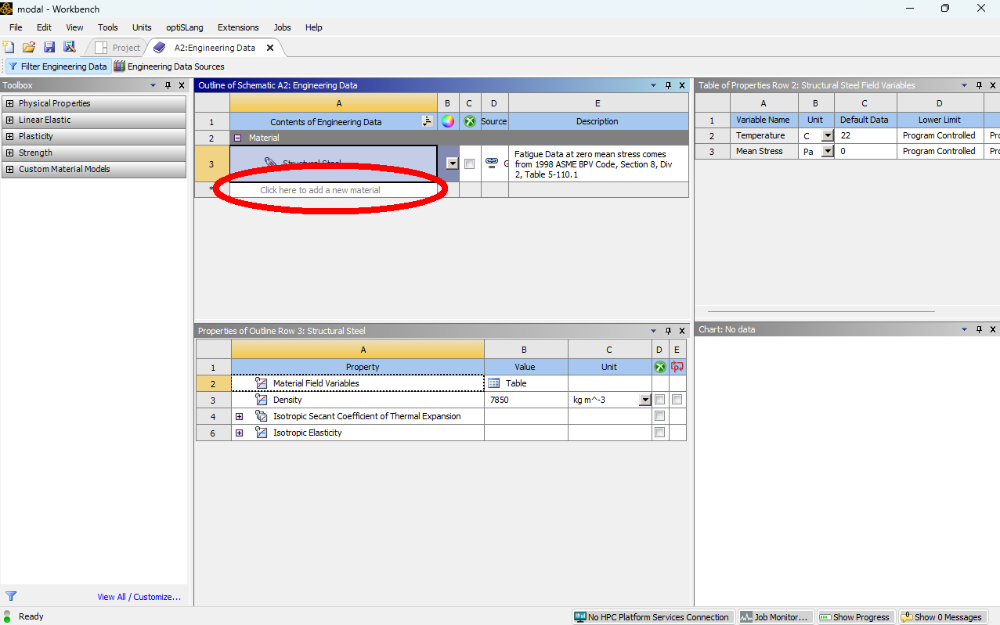{width=900px}](media/08_modalanalyse/02a_material_hier_klicken.en.png "Click here to create a new material"){.glightbox}

2. Add **Density** and **Isotropic Elasticity** from the toolbox. Enter the following values and check the units:

    | Property | Value |
    | :---- | :---- |
    | Density | \(2.7\,\mathrm{kg/dm^3}=2,700\,\mathrm{kg/m^3}\) |
    | Young’s modulus | \(70\,\mathrm{GPa}=70,000\,\mathrm{MPa}\) |
    | Poisson’s ratio | \(0.35\) |

3. Return to the model in Mechanical and assign *Aluminium_Modal* to the beam.

The database alloy shown under [Material Assignment](05_elementtypen_ansatzf.en.md#material-assignment) has \(\nu=0.33\). For this task, use the properties specified here for the material you created yourself.

<!-- SCREENSHOT: 02_aluminium_neu_anlegen.en.png
In Engineering Data, select the newly created Aluminium_Modal material.
Capture the material overview, toolbox and properties together, with readable units.
Show Density = 2.7 kg/dm³ or 2,700 kg/m³ and Isotropic Elasticity with Young's Modulus = 70 GPa
or 70,000 MPa and Poisson's Ratio = 0.35.
If needed, add a separate capture showing entry of the new material name.
Replace this PNG directly; keep the filename and image link.
-->

[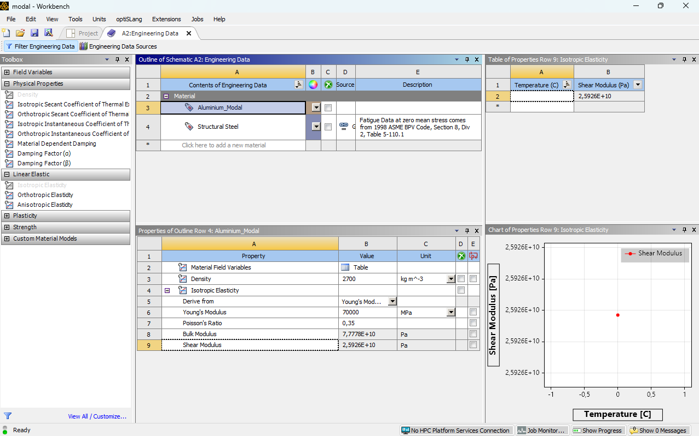{width=900px}](media/08_modalanalyse/02_aluminium_neu_anlegen.en.png "Creating the new Aluminium_Modal material"){.glightbox}

Use the established meshing procedure.

### 3. Boundary Conditions

Start with the **free analysis without supports**. For the cantilever variant, subsequently fix one end face and leave the other free. For the fixed-at-both-ends case, change the supports according to the task definition.

### 4. Analysis Settings

Request the first **ten modes**. Do not restrict the search range for this introduction. The standard analysis is **undamped**; it does not determine damping ratios. The required number of modes must be chosen separately for other questions.

<!-- SCREENSHOT: 03_modalanalyse_einstellungen.en.png
Cantilever aluminium beam; ten modes, no restriction of the search range, undamped solution. Capture the tree
and settings together in the English interface.
Replace this PNG directly; keep the filename and image link.
-->

[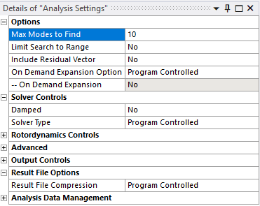{width=900px}](media/08_modalanalyse/03_modalanalyse_einstellungen.en.png "Beam analysis settings"){.glightbox}

!!! note "Free models and rigid body modes"
    A free, connected 3D body has three translational and three rotational rigid body modes. Their natural frequencies are theoretically zero; small numerical deviations may occur. These modes belong to the free model. Adding supports would change the question being investigated [@AnsysFreeModal].

### 5. Evaluating Mode Shapes

After solving, inspect the natural frequencies in the results table. Select the required entries and use *Create Mode Shape Results* in the context menu to generate the corresponding results. Inspect the shapes individually and using the animation.

<!-- SCREENSHOT: 04_eigenfrequenzen_eigenformen_erzeugen.en.png
After solving, show the ten frequencies of the cantilever course beam. Select the required table rows and open
the context menu for Create Mode Shape Results. Capture readable frequencies and menu entries.
Replace this PNG directly; keep the filename and image link.
-->

[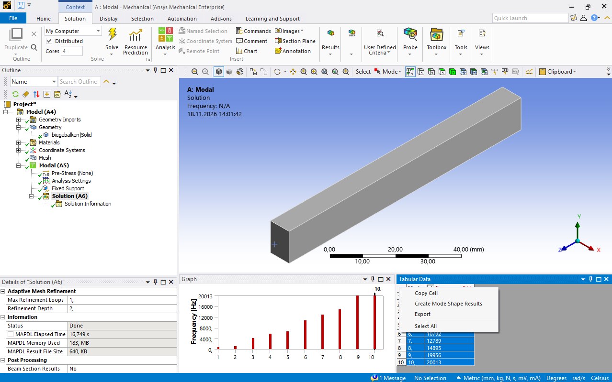{width=900px}](media/08_modalanalyse/04_eigenfrequenzen_eigenformen_erzeugen.en.png "Natural frequencies and mode shape results"){.glightbox}

* **Natural frequency:** At which frequency can this free natural vibration occur?
* **Mode shape:** How do the regions move relative to each other? Is the motion, for example, bending, torsion or rigid body motion?
* **Scaling:** The displayed shape is normalised and scaled for visualisation. The absolute value in a deformation legend is not an operating displacement. The relative spatial distribution is meaningful.

!!! warning "No operating displacement from modal analysis"
    A displayed deformation in mm or m must not be interpreted as a real vibration amplitude. This also applies to strains and stresses derived from a mode shape: their relative distribution is meaningful, rather than their absolute level. The animation illustrates the mode shape; it is not a calculated operating time history.

<!-- SCREENSHOT: 05_eigenform_skalierung_animation.en.png
Select a bending mode from the same beam solution. Show the complete beam, clamp, mode number, frequency,
deformation legend, and scaling and animation controls. Do not present the scaled values as operating
displacements.
Replace this PNG directly; keep the filename and image link.
-->

[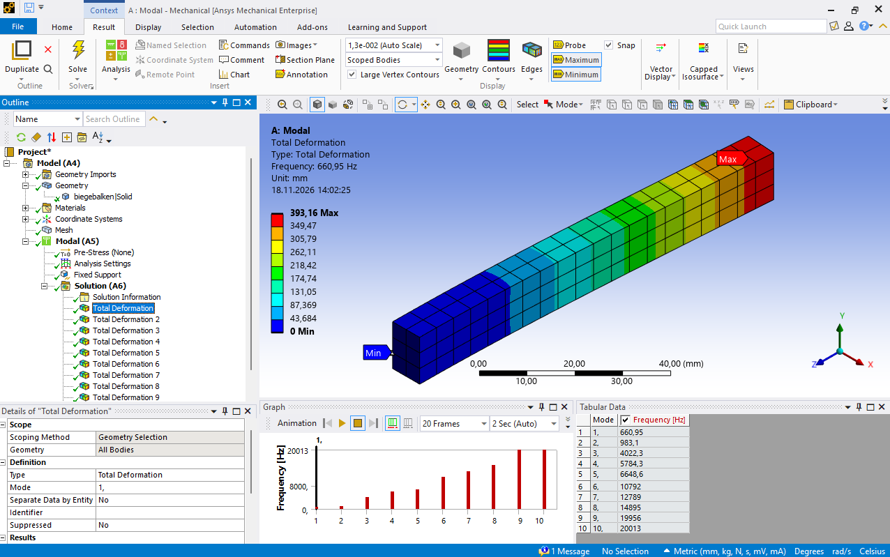{width=900px}](media/08_modalanalyse/05_eigenform_skalierung_animation.en.png "Mode shape, scaling and animation"){.glightbox}

The amplitude under a specific harmonic load is a separate frequency response question. It also requires the load distribution, excitation frequency and damping.

### 6. Participation Summary

Under *Solution Information*, select *Solution Output → Participation Factor Summary*. This provides participation factors, effective masses and mass ratios, among other quantities.

<!-- SCREENSHOT: 06_beteiligungsfaktoren.en.png
For the same beam, select Participation Factor Summary under Solution Information / Solution Output. Show the
selection and tables for participation factor, effective mass and ratios to total mass. Make two transverse
directions and units readable; add a second capture if needed.
Replace this PNG directly; keep the filename and image link.
-->

[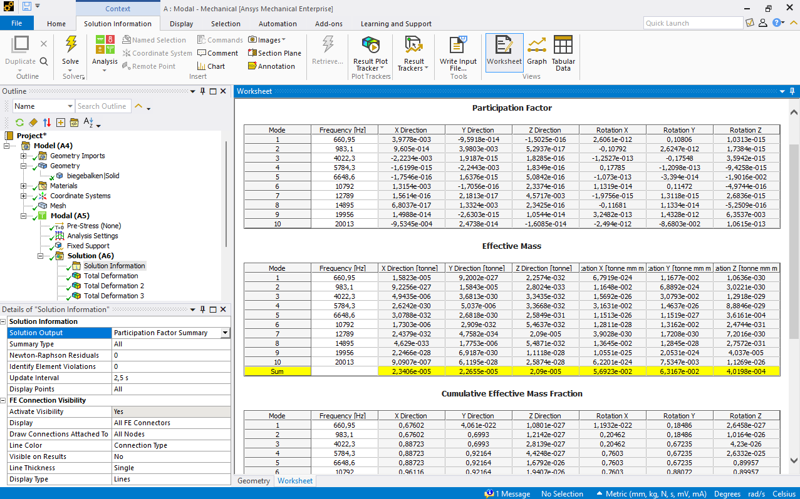{width=900px}](media/08_modalanalyse/06_beteiligungsfaktoren.en.png "Opening and reading the participation summary"){.glightbox}

??? note "Participation Factor and Effective Modal Mass"

    These quantities help assess modes for a **defined excitation direction**. For a common directional motion of the supports, for example, they indicate which modes are important for the resulting inertial excitation.

    | Quantity | Practical interpretation |
    | :---- | :---- |
    | Participation factor | Coupling of a mode to the translational or rotational direction considered |
    | Effective modal mass | Directional weighting of this participation; not a spatially separate component mass |
    | Sum of effective mass ratios relative to total mass | Indication of how much of this directional participation is represented by the included modes |

    **Directional comparison:** Compare two excitation directions and relate notable values to the mode shapes.

    A local force has its own spatial load distribution. Its modal excitation follows from projection onto the mode shape, \(Q_i=\Phi_i^T p\). A mode with a small effective mass can therefore still be relevant for an appropriately applied local force.

    ANSYS distinguishes *Cumulative Effective Mass Fraction*, referenced to the calculated modes, from *Ratio of Effective Mass to Total Mass*. The former reaches 1 at the end of the included mode list; this does not imply complete coverage of the total mass. A blanket “90% reached, therefore sufficient” replaces neither checking the excitation and frequency range nor establishing convergence of the response quantity of interest [@AnsysModalParticipation; @AnsysMassTheory].

### Further Variants

Investigate the remaining support and material variants in the task definition. Compare corresponding mode shapes; the mode number alone is insufficient to match them.

## Task Definition: Steel Plate

Use [stahlplatte.stp](media/08_modalanalyse/stahlplatte.stp). Check the dimensions: length **680 mm**, width **100 mm**, thickness **3 mm**. Use *Structural Steel*.

1. Investigate the plate without constraints and identify the rigid body modes.
2. Fix the left end face and determine the first **five natural frequencies and mode shapes**.
3. Fix both end faces and again determine the first **five natural frequencies and mode shapes**. Compare the shapes with the cantilever case.

## Task Definition: Gear Shaft

Use [getriebewelle.stp](media/08_modalanalyse/getriebewelle.stp) and the material *Aluminium_Modal* you defined yourself, with \(\rho=2.7\,\mathrm{kg/dm^3}\), \(E=70\,\mathrm{GPa}\) and \(\nu=0.35\).

1. Calculate the first **ten natural frequencies**. Apply *Fixed Support* at both ends.
2. Discuss which mode shapes and natural frequencies could be relevant to machine operation. Which excitation information is missing for a conclusive assessment?
3. Add a point mass of **10 kg** at the centre of the shaft section with the largest diameter. How do the natural frequencies and mode shapes change?

### Adding the Point Mass

In Mechanical, select **Geometry** in the model tree. On the **Geometry** tab, choose **Point** in the **Mass** group to insert a **Point Mass**. Position it at the centre of the shaft section with the largest diameter, select the attachment region and enter **10 kg** under **Mass**.

The **Behavior** setting determines how the mass is coupled to the selected geometry. The options **Rigid** and **Deformable** have the following meanings:

* **Rigid:** The attached geometry regions move together as a rigid body. Their relative deformation is suppressed. The coupling can therefore additionally stiffen the shaft in the attachment region.
* **Deformable:** The attached geometry remains free to deform. The mass is coupled without making the selected region rigid.

In practice, a point mass often replaces a component whose geometry is not to be modelled in full. If that component is much stiffer than the shaft and connects its attachment region approximately rigidly, **rigid coupling** is a suitable simplification. If the main intention is to represent an additional mass without the corresponding stiffening, **deformable coupling** is suitable [@AnsysRemotePointBehaviour].

<!-- SCREENSHOT: 07_welle_punktmasse.en.png
English capture available: Geometry tab, Point in the Mass group, Point Mass under Geometry,
Mass = 10 kg and Behavior = Rigid are visible. Keep the filename and image link when updating the capture.
-->

[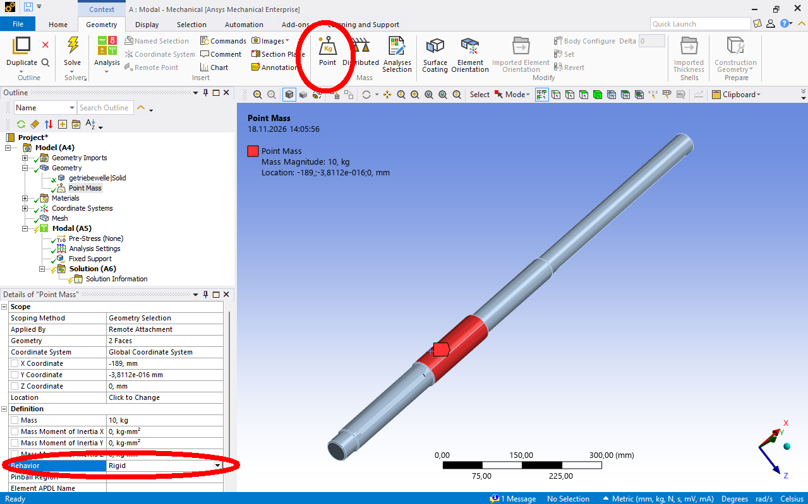{width=900px}](media/08_modalanalyse/07_welle_punktmasse.en.png "10 kg point mass on the gear shaft"){.glightbox}

## Task Definition: Wind Turbine

Import [windrad.stp](media/08_modalanalyse/windrad.stp). The assembly comprises the components *Rotoreinheit*, *Gondel*, *Turm* and *Bodenplatte*. The focus is on the **natural frequencies of the component Turm**. For simplification, *Gondel* and *Rotoreinheit* are treated as rigid bodies in both variants.

1. Assign *Structural Steel* to all components and calculate the first **six natural frequencies**. Identify the mode shapes.
2. Change the material of *Turm* to aluminium and the material of *Rotoreinheit* to a polymer. How does the material selection affect the natural frequencies of *Turm*?

The ground support conditions and polymer definition are deliberately left for you to choose and justify. Document the material properties, contacts and couplings used. Rigid bodies also require the appropriate mass and mass moments of inertia; changing their material can therefore affect the natural frequencies of *Turm*.

### Rigid Bodies and Connections

The components *Gondel* and *Rotoreinheit* are modelled as rigid bodies. They can move and rotate, but do not deform. Their mass and mass moments of inertia are still included in the calculation.

<!-- SCREENSHOT: 08_windenergie_starrkoerper_kopplung.en.png
Show Gondel and Rotoreinheit as rigid bodies. Capture the tree, body selection, rigid-body definition and
connection to the deformable Turm; add a second detail capture if needed. Preserve the open choice of ground
supports and polymer. Do not imply that one variant is the only correct solution.
Replace this PNG directly; keep the filename and image link.
-->

[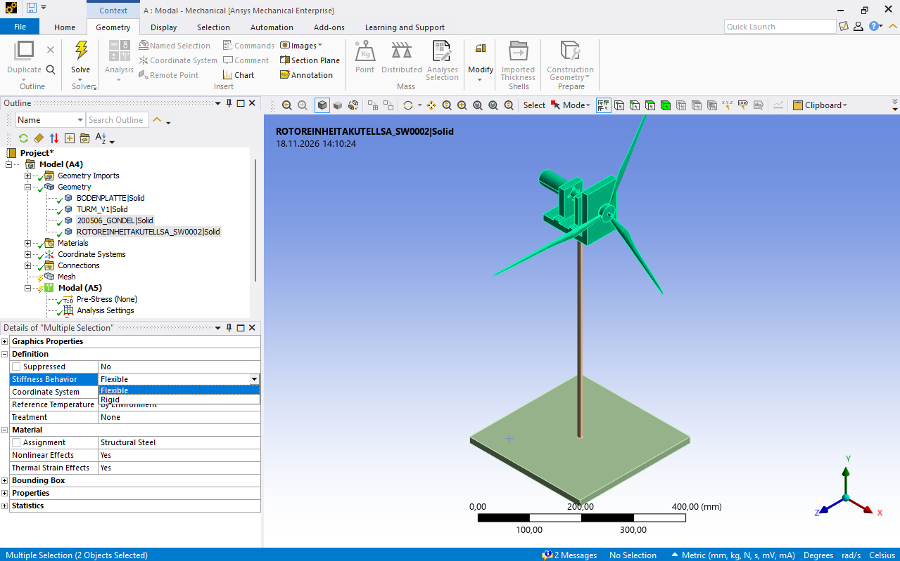{width=900px}](media/08_modalanalyse/08_windenergie_starrkoerper_kopplung.en.png "Wind turbine rigid bodies and couplings"){.glightbox}

Components that are firmly connected can be modelled using *Bonded* contact. An overview of contact types is provided in the [Contacts](02_installation_erste_schritte.en.md#contacts) section.

Contacts are listed in the model tree under **Connections → Contacts**. Select a contact region to display the associated faces and settings, as illustrated below.

<!-- SCREENSHOT: 09_windenergie_kontakte.en.png
Capture the English interface with Connections and Contacts expanded in the model tree.
Select a contact region and show the associated faces and settings, matching the German view.
The image is for interface orientation and does not prescribe a contact configuration.
Replace this PNG directly; keep the filename and image link.
-->

[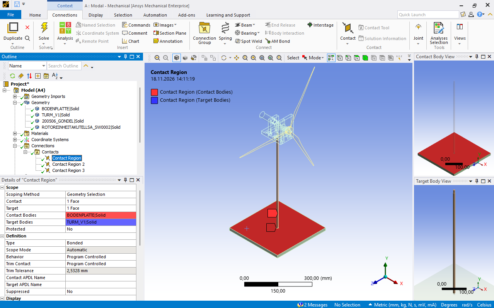{width=900px}](media/08_modalanalyse/09_windenergie_kontakte.en.png "Contacts under Connections in the model tree"){.glightbox}

!!! warning "Automatic contact detection"
    Check automatically generated contacts and the connection of the rigid bodies to *Turm*. Do not accept detected connections without checking them.

## Discussion of Results

* How do mass distribution, stiffness and boundary conditions change the corresponding natural frequencies and mode shapes?
* Have rigid body modes, local modes and global bending or torsional modes been identified correctly?
* How sensitive are the results to idealised supports, material properties and connection stiffnesses?
* Which excitation frequencies and load distributions would need to be known to assess operational relevance?
* What can modal analysis establish, and which conclusions require a load response or comparison with measurements?

## Further Reading

### Experimental Modal Analysis

Experimental modal analysis determines natural frequencies, modal damping ratios and mode shapes from measured input and output signals. An instrumented impact hammer or shaker excites the structure. The force is measured, and the response is recorded, for example, using accelerometers at defined positions and in defined directions [@BKModalParameters].

[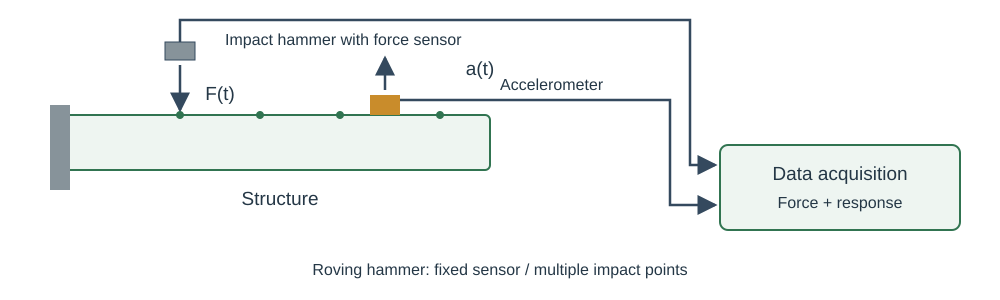{width=900px}](media/08_modalanalyse/ema_messaufbau.en.svg "Experimental modal analysis measurement setup"){.glightbox}

Complex frequency response functions (FRFs) are estimated from the measured signals. When acceleration is related to the applied force, the FRF has units of \((\mathrm{m/s^2})/\mathrm{N}\). An FRF contains magnitude and phase; appropriate spectral estimators are used for noisy measurements, rather than simply dividing time histories [@BKModalParameters; @ARTeMISModal].

There are two simple measurement arrangements for spatial identification: with a **roving hammer**, the sensor stays at a reference point while different points are excited. With a **roving sensor**, the excitation point stays fixed while the sensor is moved. The position and direction of each measurement are recorded; the mode shape is identified from the associated FRFs [@VRModalTesting].

[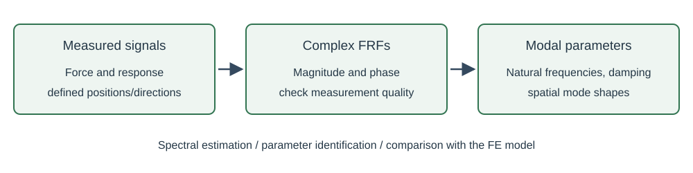{width=900px}](media/08_modalanalyse/ema_auswertung.en.svg "Experimental modal analysis processing"){.glightbox}

Resonance peaks provide initial indications of modes. A single peak does not provide a complete mode shape: spatially distributed measurements are required. A mode may be barely visible if the excitation or measurement point lies on a vibration node. Damping and neighbouring modes require appropriate parameter identification; modern methods fit a modal model to the FRFs [@BKModalParameters; @ARTeMISModal].

Measurement quality should be checked for frequency resolution, excitation bandwidth, double hits, windowing and coherence, among other factors. High coherence alone is not a complete demonstration of quality [@VRModalTesting].

When comparing with an FE model, the measurement and model boundary conditions must be matched. Differences can arise from supports, connections, material properties and added sensor masses. Such a comparison checks the model; without measurement data, there is no experimental validation. Undamped FE modal analysis also provides no measured damping ratios.

### Transition to Frequency Response

Modal analysis answers: **Which mode shapes and natural frequencies does the structure possess?** Harmonic analysis adds: **What are the amplitude and phase under a prescribed harmonic load?** For a complex load amplitude \(\hat p\):

\[
\left(K-\omega^2M+\mathrm{i}\omega C\right)\hat u=\hat p
\]

This follows by substituting \(u(t)=\operatorname{Re}(\hat u\,\mathrm{e}^{\mathrm{i}\omega t})\) into the general equation of motion. Mode superposition uses the previously calculated mode shapes as a reduced basis; the included modes must suit the load, frequency range and response quantity [@AnsysHarmonicTheory].

## Quiz for Self Assessment

<!-- markdownlint-disable MD033 -->

<?quiz?>
question: What does the maximum value of a scaled mode shape tell us?
answer: It gives the real operating displacement.
answer-correct: It belongs to the normalisation; the relative deformation distribution is meaningful.
answer: It determines damping.
content:
The mode shape is scaled. An operating displacement requires a load response with a specified excitation and damping.
<?/quiz?>

<?quiz?>
question: How many rigid body modes does a free, connected 3D body have?
answer-correct: Six
answer: One
answer: Ten
content:
Three translations and three rotations give six rigid body modes. Their frequencies are theoretically zero.
<?/quiz?>

<?quiz?>
question: What follows from a large effective mass ratio in one direction?
answer: The real amplitude is large.
answer: Every local force strongly excites this mode.
answer-correct: The mode is important for the corresponding directional inertial excitation.
content:
Effective modal mass refers to an excitation direction. For a local force, its spatial distribution must also be considered.
<?/quiz?>

<?quiz?>
question: Which additional information is needed for a harmonic load response?
answer: Only the colour of the mode shape
answer-correct: The load definition and damping, together with the frequency range considered
answer: Only the mode number
content:
Natural frequencies and mode shapes alone do not determine the amplitude under an external force.
<?/quiz?>

<!-- markdownlint-enable MD033 -->
