# Modul 06 – Modalanalyse

## Lernziele

In diesem Modul werden folgende Inhalte und Kompetenzen vermittelt:

* Bedeutung von Eigenfrequenzen und Eigenformen für Bauteile und Baugruppen
* Herleitung grundlegender Zusammenhänge aus einfachen Feder Masse Systemen
* Einfluss der Einspannung und der Massenverteilung auf das Eigenschwingungsverhalten
* Umsetzung einer Modalanalyse in ANSYS Mechanical
* Interpretation und Bewertung von Modenformen
* Übertragung auf komplexere Baugruppen mit starren und verformbaren Teilen

## Motivation und zentrale Fragestellungen

Schwingungen treten in technischen Systemen in vielfältiger Form auf. Bereits einfache Beobachtungen zeigen, dass Strukturen nicht beliebig schwingen, sondern charakteristische, systemabhängige Muster ausbilden. Diese Muster entstehen nicht zufällig, sondern entsprechen dem Eigenschwingverhalten des jeweiligen Systems.  

Die folgenden Filmsequenzen verdeutlichen typische Situationen, in denen sich dieses Eigenverhalten unmittelbar beobachten lässt. Die Beispiele reichen von alltäglichen Objekten bis hin zu technischen Bearbeitungsprozessen und dienen als Ausgangspunkt für die Analyse der zugrunde liegenden Mechanismen.

### Schwingung einer Straßenlaterne

<!-- markdownlint-disable MD033 -->
<video controls width="700">
  <source src="../media/08_modalanalyse/lampe.mp4" type="video/mp4">
  Ihr Browser kann dieses Video nicht wiedergeben.
</video>
<!-- markdownlint-enable MD033 -->

??? question "Was lässt sich in dieser Filmsequenz erkennen?"

    * Die Lampe führt eine freie Schwingung aus.  
    * Die Bewegung konzentriert sich in einer charakteristischen Form, die einer Eigenform des Systems entspricht.  
    * Dass die Laterne in dieser Form schwingt, liegt daran, dass der Wind Anregungsanteile enthält, die die Eigenfrequenz des Systems treffen.

---

### Schwingung einer Tischplatte

<!-- markdownlint-disable MD033 -->
<video controls width="700">
  <source src="../media/08_modalanalyse/tisch.mp4" type="video/mp4">
  Ihr Browser kann dieses Video nicht wiedergeben.
</video>

??? question "Welche Phänomene treten hier auf?"

    * Die Tischplatte ist im Gestell offenbar sehr weich gelagert; bereits geringe Kräfte können zu einer Verdrehung des gesamten Aufbaus führen.  
    * Nach dem Loslassen führt die Platte eine freie Schwingung aus, was auf eine Kombination aus geringer Steifigkeit des Untergestells und relativ hoher Masse der Platte hinweist.  
    * Ein solcher Aufbau ist strukturdynamisch ungünstig: geringe Gestellsteifigkeit in Kombination mit großer Plattenmasse führt zu ausgeprägtem Eigenschwingverhalten.  

---

### Aeroelastische Instabilität der Tacoma-Narrows-Brücke

<!-- markdownlint-disable MD033 -->
<iframe  
    width="700"  
    height="394"  
    src="https://www.youtube-nocookie.com/embed/XggxeuFDaDU?cc_load_policy=0&cc_lang_pref=en&hl=en"  
    title="Tacoma Narrows Bridge Collapse"
    frameborder="0"  
    allow="accelerometer; autoplay; clipboard-write; encrypted-media; gyroscope; picture-in-picture"  
    allowfullscreen
    playsinline>
</iframe>
<!-- markdownlint-enable MD033 -->

??? question "Welche strukturdynamischen Effekte sind sichtbar?"

    * Die Brücke zeigt ausgeprägte Torsionsschwingungen mit stark zunehmender Amplitude.
    * Eigenfrequenzen und Eigenformen charakterisieren das schwingungsfähige Tragwerk und sind Grundlage seiner aeroelastischen Betrachtung.
    * Beim aeroelastischen Flattern verändert die Bewegung des Brückendecks die Luftkräfte. Diese wirken auf die Bewegung zurück und können ihr mehr Energie zuführen, als durch Dämpfung verloren geht.
    * Diese Selbsterregung ist von erzwungener Resonanz durch eine vorgegebene periodische äußere Kraft zu unterscheiden. Eine solche Erregerfrequenz muss hier nicht mit einer Eigenfrequenz übereinstimmen.
    * Eine reine strukturelle Modalanalyse beschreibt Eigenformen und Eigenfrequenzen, genügt aber nicht zur Beurteilung der aeroelastischen Stabilität [@WSDOTTacomaFailure].

---

### Vibrationen beim Fräsen

<!-- markdownlint-disable MD033 -->
<iframe  
    width="700"  
    height="394"  
    src="https://www.youtube-nocookie.com/embed/__yQcF4G7tM?start=37&end=105&cc_load_policy=0&cc_lang_pref=en&hl=en"  
    title="Machining vibration example"
    frameborder="0"  
    allow="accelerometer; autoplay; clipboard-write; encrypted-media; gyroscope; picture-in-picture"  
    allowfullscreen
    playsinline>
</iframe>
<!-- markdownlint-enable MD033 -->

??? question "Welche Hinweise auf Eigenfrequenzen liefert diese Bearbeitung?"

    * Das Werkzeug beginnt zu schwingen, sobald die Schnittbedingungen eine dynamisch instabile Konfiguration erzeugen. Diese liegt vor, wenn die Rückkopplung zwischen Werkzeugbewegung und Spanbildungsprozess Schwingungen verstärkt statt dämpft.  
    * Die entstehende Rattermarke ist ein direktes Abbild der Werkzeugschwingung und zeigt die dominierende Eigenform des Systems.  
    * Das Gesamtsystem Werkzeug–Spindel–Werkstück weist eine oder mehrere charakteristische Eigenfrequenzen auf, in deren Nähe das Schwingungsverhalten besonders ausgeprägt ist.  
    * Dynamische Instabilität entsteht, wenn die Prozessanregung Anteile im Bereich einer Eigenfrequenz enthält und die Systemdämpfung nicht ausreicht, um die Schwingung zu reduzieren.  
    * In der Filmsequenz ist eine aktive Schwingungsreduzierung sichtbar. Deren Wirkung zeigt sich darin, dass die Schwingungsamplitude zeitweise deutlich reduziert wird, da der Dämpfer dem System aktiv Energie entzieht und somit das Eigenschwingverhalten beeinflusst.  

---

### Schwingungen eines Maschinenunterbaus

<!-- markdownlint-disable MD033 -->
<video controls width="700">
  <source src="../media/08_modalanalyse/unterbau.mp4" type="video/mp4">
  Ihr Browser unterstützt das Abspielen von Videos nicht.
</video>
<!-- markdownlint-enable MD033 -->

??? question "Welche strukturdynamischen Aspekte treten hier hervor?"

    * Das Video zeigt eine Zusammenfassung zahlreicher Eigenformen eines Maschinenunterbaus, wie sie in einer FEM-Modalanalyse berechnet werden.  
    * Die dargestellten Moden decken einen breiten Frequenzbereich ab und verdeutlichen, dass technische Systeme viele charakteristische Eigenformen besitzen, die sich lokal oder global ausprägen können.  
    * Die sichtbaren Schwingungsmuster werden durch die Verteilung von Masse und Steifigkeit bestimmt.
    * Niedrigfrequente Eigenformen betreffen oft den gesamten Aufbau, während höherfrequente Moden lokal konzentrierte Verformungen aufweisen.  
    * Die Vielzahl möglicher Eigenformen erklärt, warum bereits geringe Anregungen – wie im vorherigen Video des Fräsprozesses – bestimmte Moden aktivieren und damit unerwünschte Schwingungen verursachen können.  

---

### Zwischenfazit

Die gezeigten Beispiele machen deutlich, dass technische Systeme nicht beliebig schwingen, sondern ausgeprägte Eigenformen besitzen, die in charakteristischen Frequenzbereichen auftreten.  

Diese Beobachtungen führen zu grundlegenden Fragestellungen:

* Welche Eigenschaften eines Systems bestimmen sein Schwingungsverhalten?  
* Warum treten Schwingungen nur in bestimmten Frequenzbereichen verstärkt auf?  
* Welche physikalischen Parameter steuern Lage und Form der Eigenmoden?  
* Wie prägen Eigenformen das Verhalten komplexer Bauteile und Baugruppen?
* Wie unterscheiden sich Einmassensysteme von kontinuierlichen Strukturen?  

Zur systematischen Analyse dieser Fragestellungen wird schrittweise vom einfachen dynamischen Modell zum komplexen technischen Bauteil übergegangen. Der Einstieg erfolgt über den Einmassenschwinger, bevor Balken, Platten, Wellen und Baugruppen untersucht werden.

---

## Theoretischer Hintergrund

### Grundbegriffe

Technische Schwingungen lassen sich durch wenige grundlegende Größen beschreiben.  

[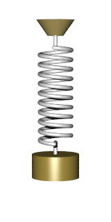{width=100px}](media/08_modalanalyse/Animated-mass-spring.gif "Feder Masse Animation"){.glightbox}
Bildquelle[@wikipedia2025]

* **Auslenkung**  
  Zeitabhängige Abweichung einer Größe (z. B. Lage) vom Gleichgewichtszustand.  

* **Periode** \(T\)  
  Zeitspanne, nach der sich ein periodischer Vorgang wiederholt.  

* **Frequenz** \(f\) und **Kreisfrequenz** \(\omega\)  
  \(f = \frac{1}{T}\)  
  \(\omega = 2 \pi f\)  

* **Amplitude** \(A\)  
  Maximale Auslenkung aus dem Gleichgewicht.  

Diese Größen bilden die Basis für die Beschreibung mechanischer Schwingungen.  

---

### Ungedämpfte Schwingung eines Einmassenschwingers

Ein großes Spektrum technischer Schwingungsprobleme lässt sich im Kern auf das lineare Feder–Masse–System zurückführen.

[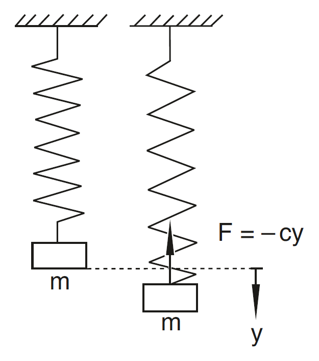{width=300px}](media/08_modalanalyse/feder_masse.png "Feder Masse System"){.glightbox}
Bildquelle[@Eichler2023]  

Die Auslenkung aus der Ruhelage wird durch \(y(t)\) beschrieben. Die rücktreibende Kraft ist proportional zur Auslenkung, jedoch entgegengesetzt gerichtet:

\[
F = -\,c\,y(t)
\]

Die Größe \(c\) ist die Federkonstante (Einheit: N/m bzw. N/mm).

#### Kräfteansatz und Bewegungsgleichung

Nach dem zweiten Newtonschen Gesetz führt die resultierende Kraft zu einer Beschleunigung:

\[
F = m\,\ddot{y}(t)
\]

Gleichsetzen beider Ausdrücke ergibt:

\[
m\,\ddot{y}(t) = -\,c\,y(t)
\]

oder in Standardform:

\[
\ddot{y}(t) + \frac{c}{m}\,y(t) = 0
\]

Hierbei handelt es sich um **lineare, homogene Differentialgleichung zweiter Ordnung** mit konstanten Koeffizienten.

---

#### Harmonischer Lösungsansatz

Eine Lösung der Form

\[
y(t) = \hat{y}\,\cos(\omega_0 t + \varphi_0)
\]

wird eingesetzt. Die Ableitungen lauten:

\[
\dot{y}(t) = -\,\hat{y}\,\omega_0 \sin(\omega_0 t + \varphi_0)
\]

\[
\ddot{y}(t) = -\,\hat{y}\,\omega_0^{2} \cos(\omega_0 t + \varphi_0)
\]

Einsetzen in die Bewegungsgleichung führt auf:

\[
-\,\hat{y}\,\omega_0^{2} \cos(\omega_0 t + \varphi_0) + \frac{c}{m}\,\hat{y}\,\cos(\omega_0 t + \varphi_0) = 0
\]

Daraus folgt die charakteristische Beziehung:

\[
\omega_0^{2} = \frac{c}{m}
\qquad\Longrightarrow\qquad
\omega_0 = \sqrt{\frac{c}{m}}
\]

Dies ist die **Eigenkreisfrequenz** des Systems.

---

#### Eigenfrequenz und Schwingungsdauer

Aus der Kreisfrequenz ergibt sich die Eigenfrequenz:

\[
f_0 = \frac{\omega_0}{2\pi}
\]

Die dazugehörige Periodendauer lautet:

\[
T_0 = \frac{1}{f_0} = \frac{2\pi}{\omega_0}
\]

Die Schwingung ist also eine **Systemeigenschaft**, bestimmt ausschließlich durch Masse und Federkonstante. Die Anfangsbedingungen beeinflussen lediglich Amplitude \(\hat{y}\) und Phase \(\varphi_0\).

#### Darstellung der Schwingung im Zeit- und Frequenzbereich

Die Eigenschaften der Lösung des Einmassenschwingers lassen sich anschaulich sowohl im Zeitbereich als auch im Frequenzbereich darstellen. Im Zeitbereich werden Auslenkung \(y(t)\), Amplitude \(\hat{y}\), Periodendauer \(T_0\) und Startphase \(\varphi_0\) sichtbar. Im Frequenzbereich zeigt sich idealisiert nur eine Frequenzkomponente bei der Eigenfrequenz \(f_0\) bzw. \(\omega_0\).  

**Zeitbereich:** Harmonische Schwingung mit markierten Kenngrößen  

[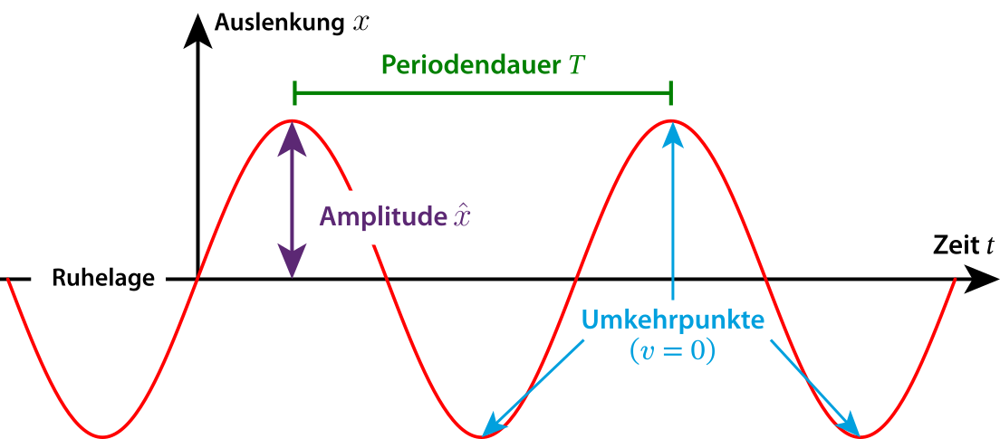{width=500px}](media/08_modalanalyse/harmonische_schwingung_zeitbereich.svg "Harmonische Schwingung (Zeitbereich)"){.glightbox}
Bildquelle[@kitmath2025]

Diese Darstellung zeigt, wie Amplitude, Periodendauer und Startphase die Form der Zeitfunktion bestimmen.

**Frequenzbereich:** Darstellung der Eigenfrequenz

[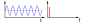{width=500px}](media/08_modalanalyse/harmonische_schwingung_frequenzbereich.svg "Harmonische Schwingung (Frequenzbereich)"){.glightbox}
Bildquelle[@physikbuch2025]

Das zugehörige Spektrum zeigt idealerweise nur eine einzige Frequenzkomponente bei der Eigenfrequenz.

---

### Gedämpfte Schwingung

Reale technische Systeme verlieren Schwingungsenergie durch Reibung, Luftwiderstand oder Materialdämpfung. Bei viskoser Dämpfung ist die Dämpfungskraft proportional zur Geschwindigkeit:

\[
m \ddot{x} + d \dot{x} + c x = 0
\]

Dabei sind \(m\) die Masse in \(\mathrm{kg}\), \(d\) die Dämpfungskonstante in \(\mathrm{N\,s/m}\) und \(c\) die Federsteifigkeit in \(\mathrm{N/m}\). Wie zuvor gilt \(\omega_0=\sqrt{c/m}\).

Es werden folgende Fälle unterschieden:  

* unterkritische Dämpfung (abklingende Schwingung)
* kritische Dämpfung (Grenzfall, schnellster Abklingvorgang ohne Schwingung)  
* überkritische Dämpfung (keine periodische Bewegung)

Für den unterkritisch gedämpften Fall \(0<d<2\sqrt{mc}\) lautet die gedämpfte Eigenkreisfrequenz:

\[
\omega_\mathrm{d} = \sqrt{\omega_0^2 - \left(\frac{d}{2m}\right)^2}
\]

[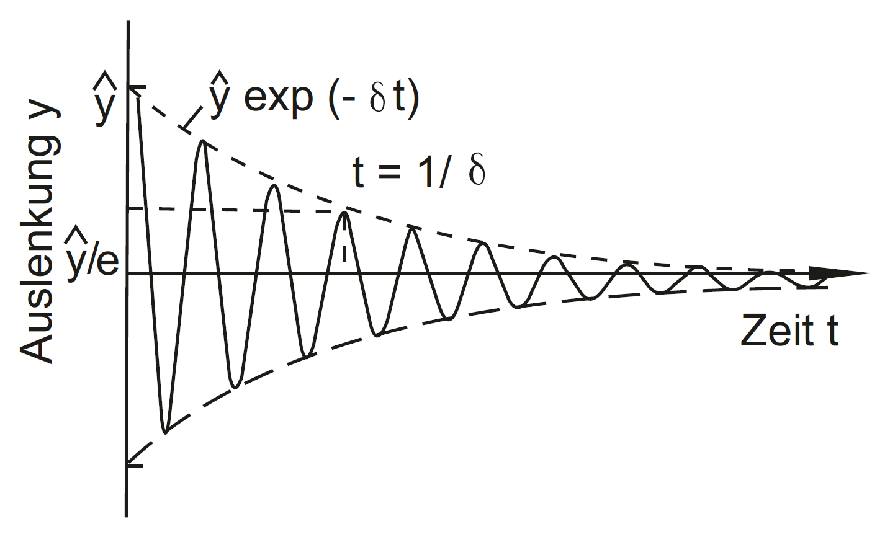{width=350px}](media/08_modalanalyse/gedaempfte_schwingung.png "Gedämpfte Schwingungen"){.glightbox}

Die Achsen zeigen die Auslenkung \(y\) über der Zeit \(t\).

Bildquelle[@Eichler2023]  

---

### Erzwungene Schwingung und Resonanz

Wirkt auf das System eine zeitabhängige äußere Kraft  

\[
F(t) = F_0 \sin(\omega t)
\]

so klingt bei vorhandener viskoser Dämpfung der freie Schwingungsanteil ab. Nach dem Einschwingvorgang bleibt eine stationäre Schwingung mit der Anregungsfrequenz \(\omega\). Bei konstanter Kraftamplitude \(F_0\) hängt ihre Amplitude von der Anregungsfrequenz und der Dämpfung ab. Bei schwacher Dämpfung liegt das Amplitudenmaximum nahe der ungedämpften Eigenkreisfrequenz \(\omega_0\). Diese Amplitudenüberhöhung wird als Resonanz bezeichnet. Ohne Dämpfung wächst die Amplitude bei \(\omega=\omega_0\) im idealisierten Modell unbegrenzt; ein endlicher stationärer Zustand stellt sich dann nicht ein [@XueDampedDriven].

Die Grafik zeigt als Beispiel die **Unwuchtantwort eines idealisierten Rotors**. Dabei sind \(n\) die Drehzahl, \(n_\mathrm{k}\) die kritische Drehzahl, \(X\) die Auslenkungsamplitude und \(e\) die Massenexzentrizität. Die Kurve gilt für ein ungedämpftes Einmassenmodell: Bei \(n=n_\mathrm{k}\) existiert keine endliche stationäre Amplitude. Der schraffierte Bereich ist schematisch gewählt und legt keine allgemeinen Grenzdrehzahlen fest [@NPTELUnbalance].

[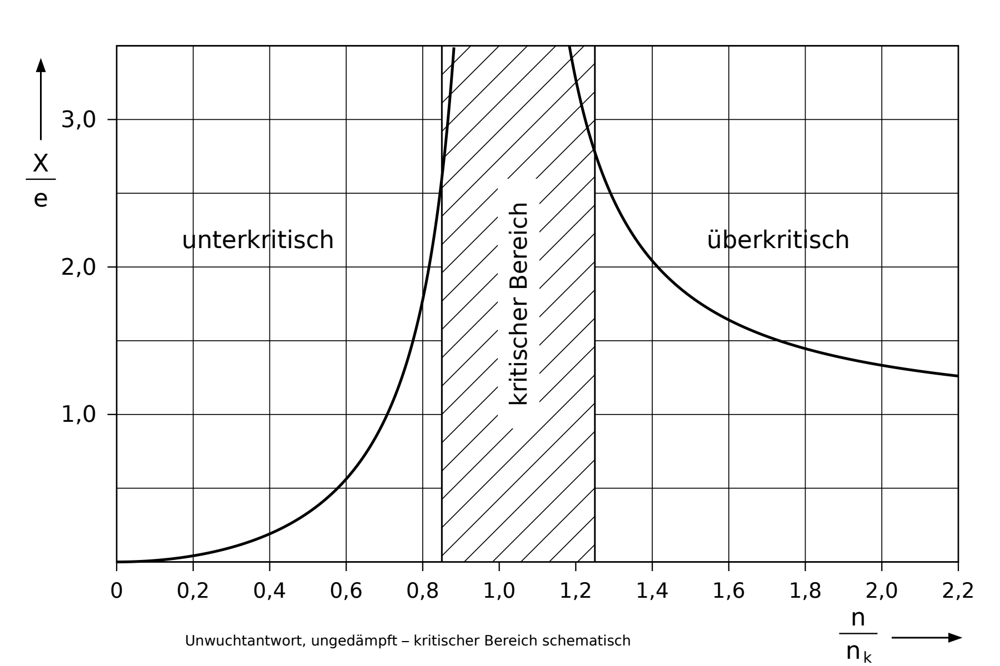{width=900px}](media/08_modalanalyse/resonanz_unwucht.png "Unwuchtantwort mit unterkritischem und überkritischem Bereich"){.glightbox}

---

### Überlagerung und Schwebung

Ein technisches System kann mehrere Schwingungsanteile gleichzeitig enthalten. Die Überlagerung zweier harmonischer Schwingungen mit leicht unterschiedlicher Frequenz führt zur Schwebung, einem alternierenden Verstärken und Abschwächen der Gesamtamplitude.

Die Überlagerung zweier Schwingungen lässt sich schreiben als:

\[
x(t) = A_1 \sin(\omega_1 t) + A_2 \sin(\omega_2 t)
\]

Die Schwebungsfrequenz ergibt sich zu:  

\[
f_\mathrm{s} = \lvert f_1 - f_2 \rvert
\]

Dieses Konzept bildet somit den Übergang zur Vorstellung einer Vielzahl von Eigenformen in realen Strukturen.  

[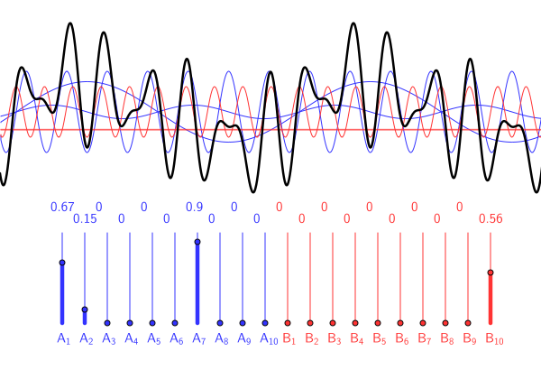{width=650px}](media/08_modalanalyse/ueberlagerung.svg "Überlagerung von Schwingungen"){.glightbox}
Bildquelle[@physikbuch2025].  

---

### Von der eindimensionalen Schwingung zur Modalanalyse

Eigenschwingungen treten nicht nur in eindimensionalen Systemen auf, sondern überall dort, wo Kontinua wie Luftsäulen, Saiten, Balken, Membranen oder Platten Schwingungen ausbilden. Diese Beispiele machen deutlich:

* reale Strukturen besitzen eine Vielzahl von Eigenfrequenzen  
* zu jeder Eigenfrequenz gehört eine charakteristische Eigenform  
* nur bestimmte Frequenzen sind mit der Geometrie und den Randbedingungen vereinbar und führen zu ausgeprägtem Schwingungsverhalten  

Diese Grundprinzipien lassen sich auf diskretisierte technische Strukturen übertragen. Für ein lineares System mit konstanten Massen-, Dämpfungs- und Steifigkeitsmatrizen gilt:

\[
M\ddot{u}(t)+C\dot{u}(t)+Ku(t)=p(t)
\]

Dabei sind \(u(t)\) der Verschiebungsvektor, \(p(t)\) der äußere Lastvektor sowie \(M\), \(C\) und \(K\) die Massen-, Dämpfungs- und Steifigkeitsmatrix. Für freie, ungedämpfte Schwingungen werden \(p(t)=0\) und \(C=0\) gesetzt. Mit \(u(t)=\Phi\,\mathrm{e}^{\mathrm{i}\omega t}\) folgt:

\[
K\Phi=\omega^2 M\Phi
\]

Die Eigenwerte \(\omega_i^2\) liefern die Eigenkreisfrequenzen; \(f_i=\omega_i/(2\pi)\) sind die Eigenfrequenzen in Hz. Die Eigenvektoren \(\Phi_i\) beschreiben die Eigenformen. Diese ungedämpfte Modalanalyse bestimmt keine Dämpfungsgrade [@AnsysModalTheory].

### Modellstufen

Die Modellwahl richtet sich nach der gesuchten Bewegung: Ein starrer Körper bildet globale Bewegungen ab, ein Mehrmassensystem relative Bewegungen diskreter Massen. Kontinuierliche Balken oder Platten besitzen räumlich verteilte Verformungen. Das FE-Modell nähert diese durch endlich viele Knotenfreiheitsgrade an. Mehr Freiheitsgrade allein garantieren dabei kein besseres Modell; Material, Lagerung und Verbindungen müssen zur Fragestellung passen.

[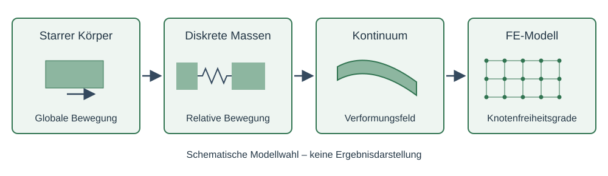{width=900px}](media/08_modalanalyse/modellstufen.svg "Modellstufen und FE-Diskretisierung"){.glightbox}

!!! info "Zur Vertiefung"
    Beitelschmidt/Dresig, *Maschinendynamik*, Kapitel „Modellbildung und Kennwertermittlung“ sowie „Lineare Systeme mit mehreren Freiheitsgraden: Modellbildung und freie Schwingungen“ [@Beitelschmidt2024].

## Aufgabenstellung Balken

Verwenden Sie [biegebalken.stp](media/08_modalanalyse/biegebalken.stp). Der Balken besitzt einen rechteckigen Querschnitt mit \(b=8\,\mathrm{mm}\), \(h=12\,\mathrm{mm}\) und eine Länge von \(L=100\,\mathrm{mm}\). Prüfen Sie die importierten Abmessungen.

Legen Sie ein **neues Material** mit dem Namen *Aluminium_Modal* an. Verwenden Sie \(\rho=2{,}7\,\mathrm{kg/dm^3}\), \(E=70\,\mathrm{GPa}\) und \(\nu=0{,}35\). Das eigenständige Definieren der Materialkennwerte ist Teil dieser Aufgabe.

1. Berechnen Sie jeweils die ersten **zehn Eigenformen** für den beidseitig freien, den einseitig fest eingespannten und den beidseitig fest eingespannten Balken.
2. Ordnen Sie Starrkörper- und elastische Moden zu. Vergleichen Sie entsprechende Eigenformen und diskutieren Sie den Einfluss der Einspannung.
3. Ändern Sie beim beidseitig eingespannten Balken das Material in *Baustahl* und vergleichen Sie die Ergebnisse.

### Analytische Lösungen einfacher Strukturen

Für einen einfachen Balken lassen sich Biegeeigenfrequenzen auch ohne FE-Modell abschätzen. Dazu wird der Balken als schlank und gleichförmig betrachtet: Er biegt sich, zusätzliche Verformungen durch Schub werden vernachlässigt. Dieses vereinfachte Modell heißt Euler-Bernoulli-Balken. Die folgende Formel gilt für einen einseitig fest eingespannten Balken mit kleinen Verformungen; auch die Rotationsträgheit wird vernachlässigt [@TUGrazCantilever].

\[
f_n=\frac{\beta_n^2}{2\pi L^2}\sqrt{\frac{EI}{\rho A}},
\qquad \beta_1\approx1{,}875,\quad\beta_2\approx4{,}694
\]

Hierbei sind \(L\) die freie Länge, \(E\) der Elastizitätsmodul, \(I\) das Flächenträgheitsmoment für die betrachtete Biegerichtung, \(\rho\) die Dichte und \(A\) die Querschnittsfläche. Mit \(E\) in Pa, \(I\) in m⁴, \(\rho\) in kg/m³, \(A\) in m² und \(L\) in m ergibt sich \(f_n\) in Hz.

Beim Rechteckquerschnitt wird für die beiden Biegerichtungen jeweils das passende Flächenträgheitsmoment eingesetzt. Verglichen werden entsprechende **Biegemoden**, nicht ungeprüft die erste und zweite Zeile der FE-Ergebnisliste. Torsions- und Längsmoden sind in dieser Formel nicht enthalten. Bei kurzen Balken und höheren Moden können die Balkenannahmen merklich von einem 3D-Modell abweichen.

??? note "Welche Zahlenwerte gelten?"

    Die Werte 1,875 und 4,694 gehören zur ersten und zweiten Biegemode des einseitig eingespannten, gleichförmigen Balkens in diesem Modell. Sie gelten nicht nur für eine bestimmte Balkenlänge oder einen bestimmten Rechteckquerschnitt: Länge, Querschnitt und Material werden separat in der Formel berücksichtigt. Für andere Lagerungen gelten andere Zahlenwerte [@TUGrazCantilever].

## Umsetzung in ANSYS – Balken

Die Anleitung erläutert die Modellierung und Auswertung am Balken. Die Lagerungs- und Materialvarianten untersuchen Sie gemäß Aufgabenstellung.

### 1. Projektverwaltung und Geometrieimport

Wählen Sie in Workbench das Analysesystem *Modal* und importieren Sie die Balkengeometrie. Für diesen Einstieg genügt eine eigenständige Modalanalyse. Eine Kopplung mit *Statisch strukturell* dient weiterführend dazu, einen vorgespannten Zustand zu berücksichtigen.

<!-- SCREENSHOT: 01_modal_projektoberflaeche.png
Workbench mit eigenständigem Modal-System und den zugehörigen Projektzellen zeigen.
Vorhandene DE-Aufnahme ist eingebunden. Bei einer Neuaufnahme Toolbox und Projektschema
lesbar zeigen; Dateiname beibehalten und EN-Pendant ebenfalls aktualisieren.
-->

[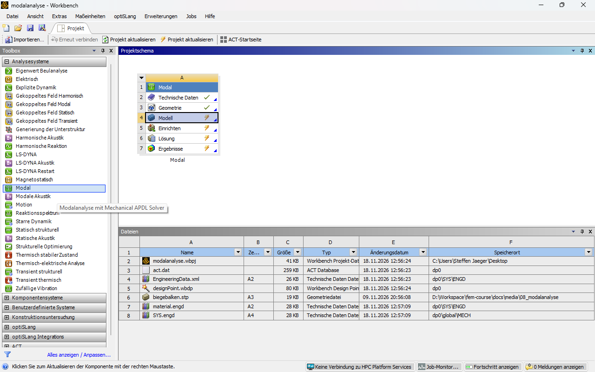{width=650px}](media/08_modalanalyse/01_modal_projektoberflaeche.png "Projektoberfläche Modalanalyse"){.glightbox}

### 2. Material und Netz

1. Öffnen Sie in Workbench die *Technischen Daten*. Klicken Sie unten in der Materialübersicht auf die Zeile *Hier klicken, um ein neues Material hinzuzufügen*. Geben Sie dort den Namen *Aluminium_Modal* ein, um das neue Material anzulegen.

    <!-- SCREENSHOT: 02a_material_hier_klicken.png
    In den Technischen Daten die Zeile zum Hinzufügen eines neuen Materials zeigen.
    Die Zeile "Hier klicken, um ein neues Material hinzuzufügen" mit einem Pfeil markieren.
    Materialübersicht und Zeile vollständig lesbar aufnehmen, möglichst vor der Namenseingabe.
    Diese PNG-Datei direkt ersetzen; Dateiname und Einbindung beibehalten.
    -->

    [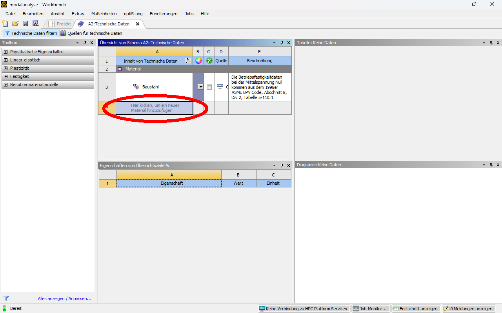{width=900px}](media/08_modalanalyse/02a_material_hier_klicken.png "Hier klicken, um ein neues Material anzulegen"){.glightbox}

2. Ergänzen Sie aus der Toolbox die Eigenschaften **Dichte** und **Isotrope Elastizität**. Tragen Sie die folgenden Werte ein und prüfen Sie die Einheiten:

    | Eigenschaft | Wert |
    | :---- | :---- |
    | Dichte | \(2{,}7\,\mathrm{kg/dm^3}=2.700\,\mathrm{kg/m^3}\) |
    | Elastizitätsmodul | \(70\,\mathrm{GPa}=70.000\,\mathrm{MPa}\) |
    | Querkontraktionszahl | \(0{,}35\) |

3. Wechseln Sie zurück zum Modell in Mechanical und weisen Sie dem Balken *Aluminium_Modal* zu.

Die in [Materialzuweisung](05_elementtypen_ansatzf.md#materialzuweisung) gezeigte Datenbanklegierung besitzt \(\nu=0{,}33\). Für diese Aufgabe gelten die hier vorgegebenen Werte des selbst angelegten Materials.

<!-- SCREENSHOT: 02_aluminium_neu_anlegen.png
In den Technischen Daten das selbst angelegte Material Aluminium_Modal auswählen.
Materialübersicht, Toolbox und Eigenschaftenbereich gemeinsam lesbar aufnehmen.
Dichte 2,7 kg/dm³ beziehungsweise 2.700 kg/m³, Isotrope Elastizität mit E = 70 GPa
beziehungsweise 70.000 MPa und Querkontraktionszahl 0,35 zeigen; Einheiten sichtbar lassen.
Die Eingabe des neuen Materialnamens bei Bedarf in einer ergänzenden Aufnahme zeigen.
Diese PNG-Datei direkt ersetzen; Dateiname und Einbindung beibehalten.
-->

[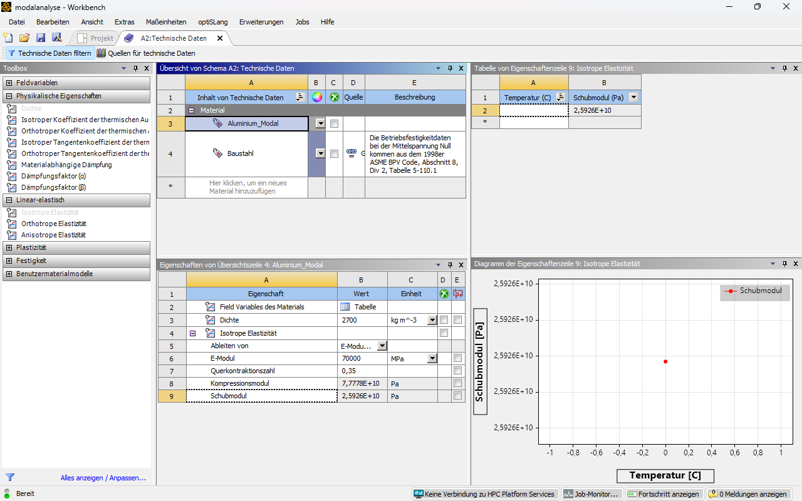{width=900px}](media/08_modalanalyse/02_aluminium_neu_anlegen.png "Neues Material Aluminium_Modal anlegen"){.glightbox}

Die Vernetzung erfolgt nach dem bekannten Vorgehen.

### 3. Randbedingungen

Beginnen Sie mit der **freien Analyse ohne Lagerungen**. Für die einseitig eingespannte Variante fixieren Sie anschließend eine Stirnfläche; die andere bleibt frei. Im beidseitig eingespannten Fall ändern Sie die Lagerung entsprechend der Aufgabenstellung.

### 4. Analyseeinstellungen

Stellen Sie die Berechnung der ersten **zehn Moden** ein. Der Suchbereich wird für diesen Einstieg nicht eingeschränkt. Die Standardanalyse ist **ungedämpft**; sie bestimmt keine Dämpfungsgrade. Die benötigte Modenanzahl ist bei anderen Fragestellungen gesondert festzulegen.

<!-- SCREENSHOT: 03_modalanalyse_einstellungen.png
Einseitig eingespannter Aluminiumbalken; zehn Moden, keine Einschränkung des Suchbereichs, ungedämpfte Lösung.
Strukturbaum und Detailfenster gemeinsam aufnehmen. Tatsächliche deutsche Menütexte zeigen.
Diese PNG-Datei direkt ersetzen; Dateiname und Einbindung beibehalten.
-->

[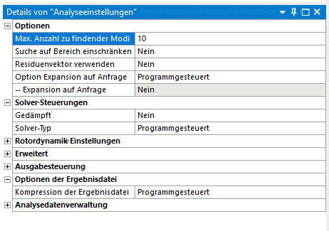{width=900px}](media/08_modalanalyse/03_modalanalyse_einstellungen.png "Analyseeinstellungen am Balken"){.glightbox}

!!! note "Freie Modelle und Starrkörpermoden"
    Ein freier, zusammenhängender 3D-Körper besitzt drei translatorische und drei rotatorische Starrkörpermoden. Ihre Eigenfrequenzen liegen theoretisch bei null; numerisch können kleine Abweichungen auftreten. Sie gehören zum freien Modell. Zusätzliche Lagerungen würden die untersuchte Fragestellung ändern [@AnsysFreeModal].

### 5. Eigenformen auswerten

Nach der Lösung werden die Eigenfrequenzen in der Ergebnistabelle betrachtet. Markieren Sie die gewünschten Einträge und erzeugen Sie die zugehörigen Eigenformergebnisse über das Kontextmenü. Prüfen Sie die Formen einzeln und mit der Animation.

<!-- SCREENSHOT: 04_eigenfrequenzen_eigenformen_erzeugen.png
Nach dem Lösen die zehn Frequenzen des einseitig eingespannten Kursbalkens anzeigen. Gewünschte Tabellenzeilen
markieren und das Kontextmenü zum Erzeugen der Eigenformergebnisse öffnen. Frequenzen und Menü lesbar
aufnehmen.
Diese PNG-Datei direkt ersetzen; Dateiname und Einbindung beibehalten.
-->

[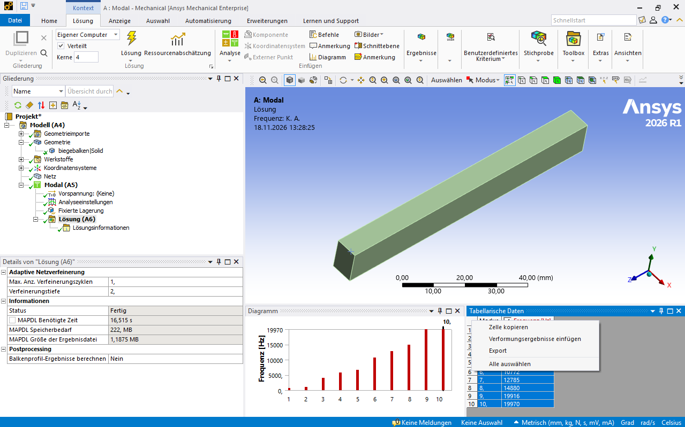{width=900px}](media/08_modalanalyse/04_eigenfrequenzen_eigenformen_erzeugen.png "Eigenfrequenzen und Eigenformergebnisse"){.glightbox}

* **Eigenfrequenz:** Bei welcher Frequenz kann diese freie Eigenschwingung auftreten?
* **Eigenform:** Wie bewegen sich die Bereiche relativ zueinander? Liegt beispielsweise eine Biege-, Torsions- oder Starrkörperbewegung vor?
* **Skalierung:** Die dargestellte Form ist normiert und zur Visualisierung skaliert. Der absolute Zahlenwert einer Verformungslegende ist keine Betriebsauslenkung. Die relative räumliche Verteilung ist dagegen aussagekräftig.

!!! warning "Keine Betriebsauslenkung aus der Modalanalyse"
    Eine angezeigte Verformung in mm oder m darf nicht als reale Schwingungsamplitude interpretiert werden. Das gilt auch für aus der Eigenform abgeleitete Dehnungs- und Spannungswerte: Aussagekräftig ist ihre relative Verteilung, nicht ihr absolutes Niveau. Die Animation veranschaulicht die Eigenform und stellt keinen berechneten Betriebszeitverlauf dar.

<!-- SCREENSHOT: 05_eigenform_skalierung_animation.png
Eine Biegemode desselben Balken-Rechenstands wählen. Gesamten Balken, Einspannung, Modennummer, Frequenz,
Verformungslegende sowie Einstellungen für Skalierung und Animation lesbar zeigen. Keine Betriebsauslenkung
behaupten.
Diese PNG-Datei direkt ersetzen; Dateiname und Einbindung beibehalten.
-->

[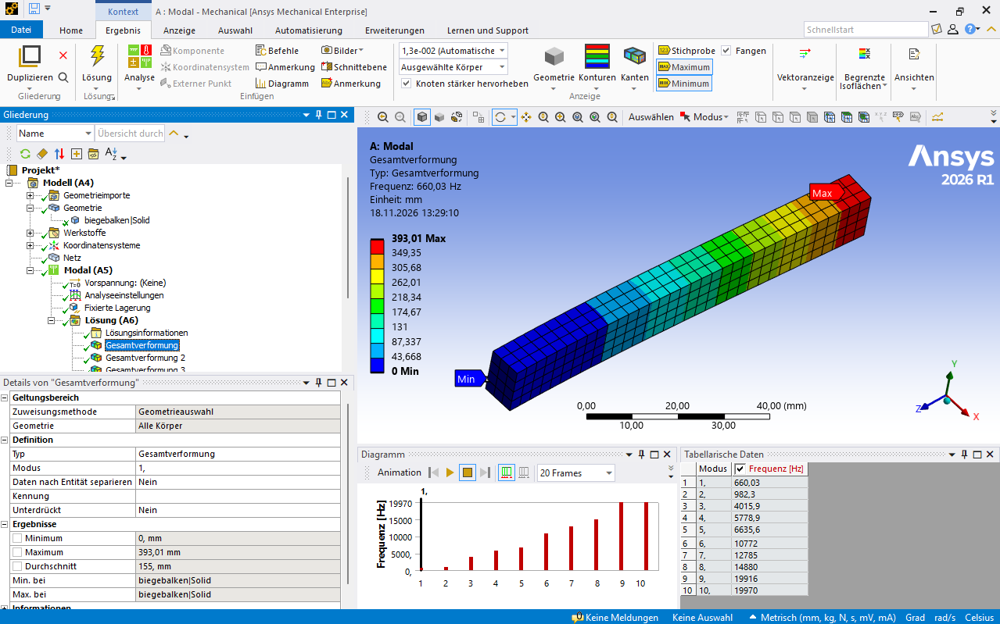{width=900px}](media/08_modalanalyse/05_eigenform_skalierung_animation.png "Eigenform, Skalierung und Animation"){.glightbox}

Welche Amplitude sich unter einer konkreten harmonischen Last einstellt, ist eine gesonderte Frage der Frequenzantwort. Dafür werden auch die Lastverteilung, Anregungsfrequenz und Dämpfung benötigt.

### 6. Zusammenfassung der Partizipationsfaktoren

Wählen Sie in den *Lösungsinformationen* die Ausgabe *Zusammenfassung der Partizipationsfaktoren*. Dort lassen sich unter anderem Beteiligungsfaktoren, effektive Massen und Massenanteile anzeigen.

<!-- SCREENSHOT: 06_beteiligungsfaktoren.png
Beim selben Balken in den Lösungsinformationen "Zusammenfassung der Partizipationsfaktoren" wählen.
Detailfenster mit Auswahl und
Tabellen für Beteiligungsfaktor, effektive Masse sowie Gesamtmassenanteile zeigen. Zwei Querrichtungen
vergleichbar und Einheiten lesbar aufnehmen; bei Bedarf ergänzende Aufnahme.
Diese PNG-Datei direkt ersetzen; Dateiname und Einbindung beibehalten.
-->

[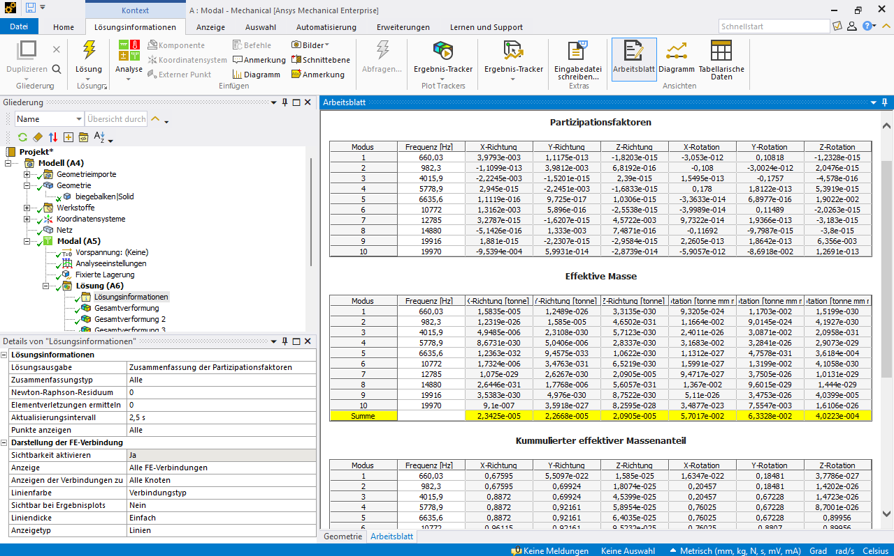{width=900px}](media/08_modalanalyse/06_beteiligungsfaktoren.png "Zusammenfassung der Partizipationsfaktoren"){.glightbox}

??? note "Beteiligungsfaktor und effektive modale Masse"

    Diese Größen helfen, Moden hinsichtlich einer **definierten Anregungsrichtung** einzuordnen. Bei einer gleichgerichteten Bewegung der Lagerung zeigen sie beispielsweise, welche Moden für die dadurch erzeugte Trägheitsanregung wesentlich sind.

    | Größe | Praktische Aussage |
    | :---- | :---- |
    | Beteiligungsfaktor | Kopplung einer Mode an die betrachtete translatorische oder rotatorische Richtung |
    | Effektive modale Masse | Richtungsbezogene Gewichtung dieser Beteiligung; keine räumlich abgetrennte Bauteilmasse |
    | Summe der effektiven Massenanteile an der Gesamtmasse | Hinweis darauf, wie viel dieser richtungsbezogenen Beteiligung durch die berücksichtigten Moden erfasst wird |

    **Richtungsvergleich:** Vergleichen Sie zwei Anregungsrichtungen und ordnen Sie auffällige Werte den Eigenformen zu.

    Eine lokale Kraft hat eine eigene räumliche Lastverteilung. Ihre modale Anregung ergibt sich aus der Projektion auf die Eigenform, \(Q_i=\Phi_i^T p\). Deshalb kann auch eine Mode mit geringer effektiver Masse bei passender lokaler Krafteinleitung relevant sein.

    ANSYS unterscheidet den kumulierten effektiven Massenanteil, der auf die berechneten Moden bezogen ist, vom Verhältnis der effektiven Masse zur Gesamtmasse. Ersterer erreicht am Ende der betrachteten Modenliste 1; daraus folgt keine vollständige Erfassung der Gesamtmasse. Ein pauschales „90 % erreicht, also ausreichend“ ersetzt weder die Prüfung der Anregung und des Frequenzbereichs noch die Konvergenz der interessierenden Antwortgröße [@AnsysModalParticipation; @AnsysMassTheory].

### Weitere Varianten

Bearbeiten Sie die übrigen Lagerungs- und Materialvarianten der Aufgabenstellung. Vergleichen Sie entsprechende Eigenformen; die Modennummer allein genügt nicht zur Zuordnung.

## Aufgabenstellung Stahlplatte

Verwenden Sie [stahlplatte.stp](media/08_modalanalyse/stahlplatte.stp). Prüfen Sie die Abmessungen: Länge **680 mm**, Breite **100 mm**, Dicke **3 mm**. Der Werkstoff sei *Baustahl*.

1. Untersuchen Sie die Platte ohne Einspannung und ordnen Sie die Starrkörpermoden ein.
2. Spannen Sie die linke Stirnfläche fest ein und bestimmen Sie die ersten **fünf Eigenfrequenzen und Eigenformen**.
3. Spannen Sie beide Stirnflächen fest ein und bestimmen Sie ebenfalls die ersten **fünf Eigenfrequenzen und Eigenformen**. Vergleichen Sie die Formen mit dem einseitig eingespannten Fall.

## Aufgabenstellung Getriebewelle

Verwenden Sie [getriebewelle.stp](media/08_modalanalyse/getriebewelle.stp) und das selbst definierte Material *Aluminium_Modal* mit \(\rho=2{,}7\,\mathrm{kg/dm^3}\), \(E=70\,\mathrm{GPa}\) und \(\nu=0{,}35\).

1. Berechnen Sie die ersten **zehn Eigenfrequenzen**. Realisieren Sie die Einspannung durch fixierte Lagerungen an beiden Enden.
2. Diskutieren Sie, welche Eigenformen und Eigenfrequenzen für den Betrieb einer Maschine relevant sein könnten. Welche Informationen zur Anregung fehlen für eine abschließende Bewertung?
3. Fügen Sie eine Punktmasse von **10 kg** mittig am größten Durchmesser der Welle hinzu. Wie verändern sich die Eigenfrequenzen und Eigenformen?

### Punktmasse ergänzen

Fügen Sie in Mechanical unter **Geometrie** eine **Punktmasse** ein. Legen Sie ihre Position mittig am größten Durchmesser der Welle fest, wählen Sie den Anbindungsbereich aus und tragen Sie die Masse von **10 kg** ein.

Das Verhalten **Starr** beziehungsweise **Verformbar** beschreibt die Kopplung an die ausgewählte Geometrie:

* **Starr:** Die angebundenen Geometriebereiche bewegen sich gemeinsam wie ein starrer Körper. Ihre relative Verformung wird unterdrückt. Dadurch kann die Kopplung die Welle im Anbindungsbereich zusätzlich versteifen.
* **Verformbar:** Die angebundene Geometrie darf sich weiterhin verformen. Die Masse wird angekoppelt, ohne den ausgewählten Bereich starr zu setzen.

In der Praxis ersetzt eine Punktmasse häufig ein Bauteil, dessen Geometrie nicht vollständig modelliert werden soll. Ist dieses Bauteil gegenüber der Welle sehr steif und verbindet es den Anbindungsbereich annähernd starr, ist die **starre Kopplung** eine passende Vereinfachung. Soll dagegen hauptsächlich eine zusätzliche Masse ohne entsprechende Versteifung berücksichtigt werden, ist die **verformbare Kopplung** geeignet [@AnsysRemotePointBehaviour].

<!-- SCREENSHOT: 07_welle_punktmasse.png
DE-Aufnahme vorhanden: Punktmasse unter Geometrie, Masse 10 kg und Verhalten Starr sind sichtbar.
Bei einer Neuaufnahme Position, ausgewählte Geometrie und Detailfenster lesbar zeigen.
Dateiname und Einbindung beibehalten.
-->

[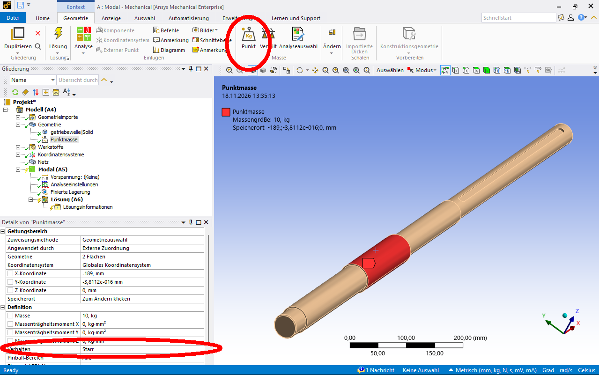{width=900px}](media/08_modalanalyse/07_welle_punktmasse.png "10-kg-Punktmasse an der Getriebewelle"){.glightbox}

## Aufgabenstellung Windenergieanlage

Importieren Sie [windrad.stp](media/08_modalanalyse/windrad.stp). Die Baugruppe besteht aus Rotoreinheit, Gondel, Turm und Bodenplatte. Gesucht sind insbesondere die **Turmeigenfrequenzen**. Gondel und Rotoreinheit werden zur Vereinfachung in beiden Varianten als Starrkörper behandelt.

1. Weisen Sie allen Bauteilen *Baustahl* zu und berechnen Sie die ersten **sechs Eigenfrequenzen**. Ordnen Sie die Eigenformen zu.
2. Ändern Sie den Turmwerkstoff in Aluminium und den Rotorwerkstoff in Kunststoff. Welchen Einfluss hat die Materialwahl auf die Turmeigenfrequenzen?

Die Bodenlagerung und die Kunststoffdefinition sind bewusst selbst zu wählen und zu begründen. Dokumentieren Sie die verwendeten Materialkennwerte, Kontakte und Kopplungen. Auch Starrkörper benötigen die zutreffende Masse und Massenträgheit; ihre Materialänderung kann deshalb die Turmeigenfrequenzen beeinflussen.

### Starrkörper und Verbindungen

Gondel und Rotor werden als Starrkörper modelliert. Sie können sich bewegen und drehen, verformen sich aber nicht. Ihre Masse und Massenträgheit werden bei der Berechnung weiterhin berücksichtigt.

<!-- SCREENSHOT: 08_windenergie_starrkoerper_kopplung.png
Gondel und Rotor als Starrkörper zeigen. Baum, Körperauswahl, Starrkörperdefinition und Verbindung zum
verformbaren Turm aufnehmen; gegebenenfalls zweite Detailaufnahme. Freie Wahl der Bodenlagerung und des
Kunststoffs erhalten. Keine Variante als einzig richtige Lösung darstellen.
Diese PNG-Datei direkt ersetzen; Dateiname und Einbindung beibehalten.
-->

[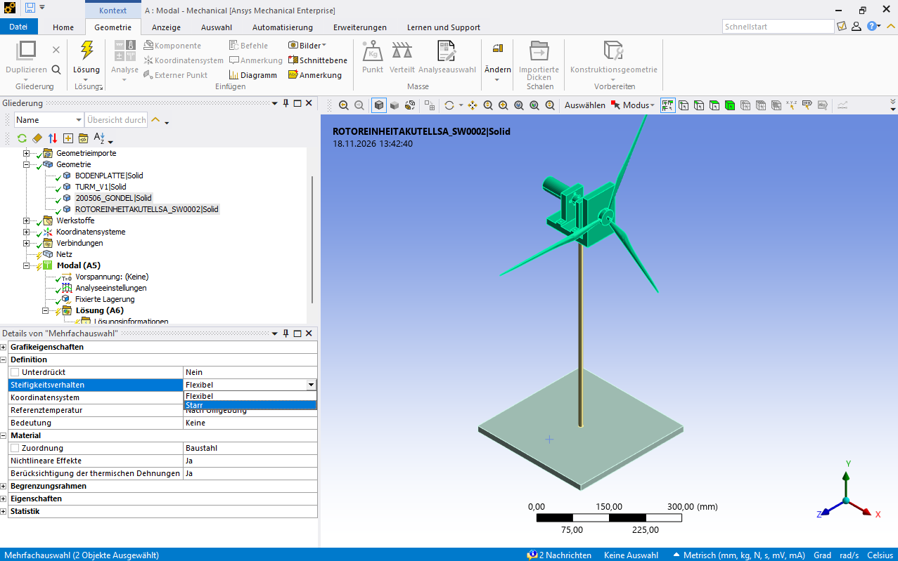{width=900px}](media/08_modalanalyse/08_windenergie_starrkoerper_kopplung.png "Starrkörper und Kopplungen der Windenergieanlage"){.glightbox}

Fest miteinander verbundene Bauteile können mit dem Kontakttyp *Verbund* modelliert werden. Eine Übersicht der Kontaktarten finden Sie im Abschnitt [Kontakte](02_installation_erste_schritte.md#kontakte).

Die Kontakte finden Sie im Strukturbaum unter **Verbindungen → Kontakte**. Wählen Sie einen Kontaktbereich aus, um die zugehörigen Flächen und Einstellungen anzuzeigen, wie in der folgenden Abbildung dargestellt.

<!-- SCREENSHOT: 09_windenergie_kontakte.png
DE-Aufnahme vorhanden: Verbindungen und Kontakte im Strukturbaum sowie einen ausgewählten Kontaktbereich zeigen.
Die Abbildung dient zur Orientierung in der Oberfläche und gibt keine Kontaktkonfiguration vor.
Dateiname und Einbindung bei einer Neuaufnahme beibehalten.
-->

[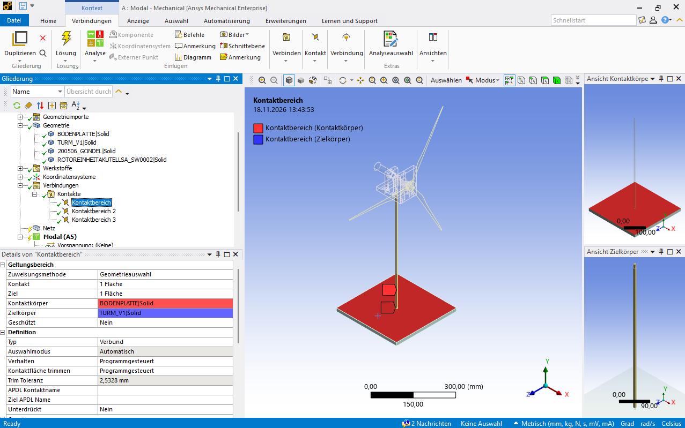{width=900px}](media/08_modalanalyse/09_windenergie_kontakte.png "Kontakte unter Verbindungen im Strukturbaum"){.glightbox}

!!! warning "Automatische Kontakterkennung"
    Prüfen Sie die automatisch erzeugten Kontakte sowie die Verbindung der Starrkörper mit dem Turm. Übernehmen Sie die erkannten Verbindungen nicht ungeprüft.

## Diskussion der Ergebnisse

* Wie verändern Masseverteilung, Steifigkeit und Randbedingungen die entsprechenden Eigenfrequenzen und Eigenformen?
* Sind Starrkörpermoden, lokale Moden und globale Biege- oder Torsionsmoden richtig zugeordnet?
* Wie empfindlich sind die Ergebnisse gegenüber idealisierten Lagerungen, Materialkennwerten und Verbindungssteifigkeiten?
* Welche Anregungsfrequenzen und Lastverteilungen müssten bekannt sein, um die Betriebsrelevanz zu beurteilen?
* Welche Aussagen erlaubt die Modalanalyse, und welche erfordern eine Lastantwort oder einen Vergleich mit Messungen?

## Weiterführendes

### Experimentelle Modalanalyse

Die experimentelle Modalanalyse bestimmt Eigenfrequenzen, modale Dämpfungsgrade und Eigenformen aus gemessenen Eingangs- und Ausgangssignalen. Ein instrumentierter Impulshammer oder ein Shaker regt die Struktur an. Die Kraft wird gemessen, die Antwort beispielsweise mit Beschleunigungssensoren an definierten Orten und in definierten Richtungen erfasst [@BKModalParameters].

[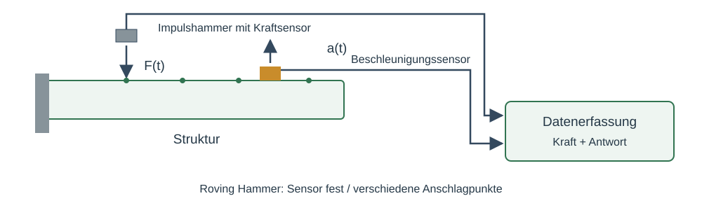{width=900px}](media/08_modalanalyse/ema_messaufbau.svg "Messaufbau der experimentellen Modalanalyse"){.glightbox}

Aus den Messsignalen werden komplexe Frequenzgangfunktionen (FRFs) geschätzt. Wird die Beschleunigung auf die eingeleitete Kraft bezogen, hat die FRF die Einheit \((\mathrm{m/s^2})/\mathrm{N}\). Die FRF enthält Betrag und Phase; bei verrauschten Messungen werden geeignete Spektralschätzer verwendet, statt die Zeitverläufe einfach zu dividieren [@BKModalParameters; @ARTeMISModal].

Für die räumliche Zuordnung gibt es zwei einfache Messabläufe: Beim **Roving Hammer** bleibt der Sensor an einem Referenzpunkt, während an verschiedenen Punkten angeschlagen wird. Beim **Roving Sensor** bleibt der Anregungspunkt fest und der Sensor wird versetzt. Position und Richtung jeder Messung werden dokumentiert; aus den zusammengehörigen FRFs wird die Eigenform bestimmt [@VRModalTesting].

[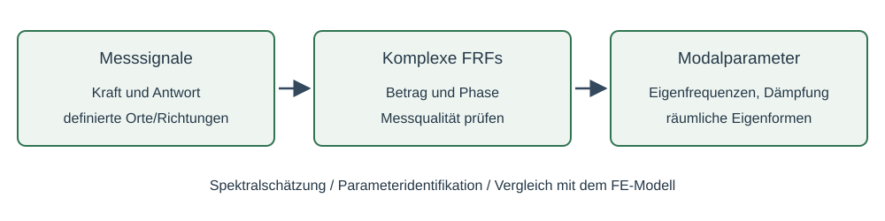{width=900px}](media/08_modalanalyse/ema_auswertung.svg "Auswertung der experimentellen Modalanalyse"){.glightbox}

Resonanzspitzen geben erste Hinweise auf Moden. Eine einzelne Spitze liefert aber keine vollständige Eigenform. Dafür sind räumlich verteilte Messungen erforderlich. Liegt der Anregungs- oder Messpunkt auf einem Schwingungsknoten, kann eine Mode kaum sichtbar sein. Dämpfung und benachbarte Moden erfordern eine geeignete Parameteridentifikation; moderne Verfahren passen hierzu ein modales Modell an die FRFs an [@BKModalParameters; @ARTeMISModal].

Die Messqualität ist unter anderem hinsichtlich Frequenzauflösung, Anregungsbandbreite, Mehrfachschlägen, Fensterung und Kohärenz zu prüfen. Eine hohe Kohärenz allein ist noch kein vollständiger Qualitätsnachweis [@VRModalTesting].

Beim Vergleich mit dem FE-Modell sind Mess- und Modellrandbedingungen abzugleichen. Abweichungen können durch Lagerung, Verbindungen, Materialdaten sowie zusätzliche Sensormassen entstehen. Ein solcher Vergleich prüft das Modell; ohne Messdaten liegt keine experimentelle Validierung vor. Die ungedämpfte FE-Modalanalyse liefert zudem keine gemessenen Dämpfungsgrade.

### Übergang zur Frequenzantwort

Die Modalanalyse beantwortet: **Welche Eigenformen und Eigenfrequenzen besitzt die Struktur?** Die harmonische Analyse ergänzt: **Wie groß sind Amplitude und Phase unter einer vorgegebenen harmonischen Last?** Für eine komplexe Lastamplitude \(\hat p\) gilt:

\[
\left(K-\omega^2M+\mathrm{i}\omega C\right)\hat u=\hat p
\]

Dies folgt aus dem Ansatz \(u(t)=\operatorname{Re}(\hat u\,\mathrm{e}^{\mathrm{i}\omega t})\) in der allgemeinen Bewegungsgleichung. Eine Modenüberlagerung nutzt die zuvor bestimmten Eigenformen als reduzierte Basis; die berücksichtigten Moden müssen für Last, Frequenzbereich und Antwortgröße geeignet sein [@AnsysHarmonicTheory].

## Quiz zur Selbstkontrolle

<!-- markdownlint-disable MD033 -->

<?quiz?>
question: Welche Aussage erlaubt der Maximalwert einer skalierten Eigenform?
answer: Er gibt die reale Auslenkung im Betrieb an.
answer-correct: Er gehört zur Normierung; aussagekräftig ist die relative Verformungsverteilung.
answer: Er bestimmt die Dämpfung.
content:
Die Eigenform ist skaliert. Erst eine Lastantwort mit festgelegter Anregung und Dämpfung liefert eine Betriebsauslenkung.
<?/quiz?>

<?quiz?>
question: Wie viele Starrkörpermoden besitzt ein freier, zusammenhängender 3D-Körper?
answer-correct: Sechs
answer: Eine
answer: Zehn
content:
Drei Translationen und drei Rotationen ergeben sechs Starrkörpermoden. Ihre Frequenzen liegen theoretisch bei null.
<?/quiz?>

<?quiz?>
question: Was folgt aus einem hohen effektiven Massenanteil in einer Richtung?
answer: Die reale Amplitude ist groß.
answer: Jede lokale Kraft regt diese Mode stark an.
answer-correct: Die Mode ist für die entsprechende richtungsbezogene Trägheitsanregung bedeutsam.
content:
Die effektive modale Masse bezieht sich auf eine Anregungsrichtung. Bei einer lokalen Kraft muss auch deren räumliche Verteilung berücksichtigt werden.
<?/quiz?>

<?quiz?>
question: Welche zusätzliche Information benötigt eine harmonische Lastantwort?
answer: Nur die Eigenfrequenzen und Eigenformen
answer-correct: Lastdefinition und Dämpfung sowie den betrachteten Frequenzbereich
answer: Nur die effektiven modalen Massen
content:
Eigenfrequenzen und Eigenformen allein bestimmen die Amplitude unter einer äußeren Kraft nicht.
<?/quiz?>

<?quiz?>
question: Welche Größen bestimmen die Eigenfrequenzen einer linearen, ungedämpften FE-Modalanalyse?
answer-correct: Die Massen- und Steifigkeitsmatrix unter Berücksichtigung der Randbedingungen
answer: Die Steifigkeitsmatrix und die vorgegebene Kraftamplitude
answer: Die Massenmatrix und die vorgegebenen Dämpfungsgrade
content:
Die Eigenwertaufgabe enthält die Massen- und Steifigkeitsmatrix. Materialdaten, Geometrie, Verbindungen und Lagerungen gehen in das Modell ein. Der Darstellungsmaßstab verändert die Eigenfrequenzen nicht.
<?/quiz?>

<?quiz?>
question: Wie lassen sich Eigenformen verschiedener Material- oder Lagerungsvarianten sinnvoll vergleichen?
answer: Gleiche Modennummern beschreiben immer die gleiche Verformungsart.
answer: Eigenformen mit gleichem angezeigtem Maximalwert gehören zusammen.
answer-correct: Die Verformungsverteilungen werden verglichen; die Reihenfolge der Moden kann sich ändern.
content:
Eine Modennummer bezeichnet die Reihenfolge im jeweiligen Ergebnis. Für die Zuordnung sind die Eigenformen selbst zu betrachten, beispielsweise ihre Biege- oder Torsionsbewegung.
<?/quiz?>

<?quiz?>
question: Was unterscheidet die starre von der verformbaren Kopplung einer Punktmasse an die Welle?
answer: Bei starrer Kopplung wird die zusätzliche Masse nicht berücksichtigt.
answer-correct: Die starre Kopplung unterdrückt die relative Verformung des Anbindungsbereichs und kann ihn zusätzlich versteifen.
answer: Die verformbare Kopplung führt unabhängig vom Modell immer zu niedrigeren Eigenfrequenzen.
content:
Beide Kopplungen berücksichtigen die Punktmasse. Die starre Kopplung lässt die angebundenen Geometriebereiche gemeinsam wie einen starren Körper bewegen; die verformbare Kopplung erlaubt ihre Verformung.
<?/quiz?>

<?quiz?>
question: Warum kann eine Materialänderung an einem als Starrkörper modellierten Rotor die Eigenfrequenzen der Windenergieanlage beeinflussen?
answer-correct: Masse und Massenträgheit des Rotors bleiben im Modell wirksam.
answer: Die Materialänderung hebt die Starrkörperannahme automatisch auf.
answer: Der E-Modul bestimmt auch bei einem Starrkörper die Verformung des Rotors.
content:
Die Starrkörperannahme unterdrückt die Verformung, nicht die Bewegung. Eine Änderung der Dichte kann Masse und Massenträgheit verändern und dadurch die Eigenfrequenzen des Gesamtsystems beeinflussen.
<?/quiz?>

<?quiz?>
question: Welche Aussage zur ungedämpften Modalanalyse ist richtig?
answer: Sie berechnet die Dämpfungsgrade aus den Abständen zwischen den Eigenfrequenzen.
answer: Sie bestimmt die Dämpfung aus dem angezeigten Maximalwert einer Eigenform.
answer-correct: Sie liefert Eigenfrequenzen und Eigenformen, aber keine Dämpfungsgrade.
content:
In der ungedämpften Modalanalyse wird die Dämpfung nicht berücksichtigt. Dämpfungsgrade lassen sich beispielsweise durch eine experimentelle Modalanalyse bestimmen.
<?/quiz?>

<?quiz?>
question: Was wird bei der experimentellen Modalanalyse benötigt, um eine räumliche Eigenform zu bestimmen?
answer: Eine einzelne Resonanzfrequenz ohne Angaben zu Messorten und Richtungen
answer-correct: Zusammengehörige Frequenzgangfunktionen an definierten Orten und in definierten Richtungen
answer: Nur die maximale Beschleunigung an einem beliebigen Punkt
content:
Eine Resonanzspitze allein beschreibt keine vollständige Eigenform. Räumlich zugeordnete Messungen, beispielsweise mit versetztem Hammer oder Sensor, liefern die erforderlichen Informationen zur Verformungsverteilung.
<?/quiz?>

<!-- markdownlint-enable MD033 -->

<!-- 
wie geht's weiter:
  - Modul 7 Thermo-Mechanik: 09_thermomechanik.md
  - Modul 8 Sensoren I (Beschl.): 10_sensor_beschl.md
  - Modul 9 Sensoren II (Druck): 11_sensor_druck.md
  - Modul 10 Kontakt: 12_kontakt.md
  - Modul 11 Ausblick: 13_ausblick.md

  | Modul | Titel | Kerninhalt |
| :----: | :---- | :---------- |
| **07** | **Thermo-mechanische Kopplung** | Temperaturfeld → thermische Dehnung → mechanische Spannung, Vergleich isotherm vs. thermisch belastet, Einfluss von Materialparametern (α, E), Beispiel: Platte mit Temperaturgradient. Alternativ Wärme aus Reibung (Bremse) |
| **8** | **Sensoren I – Beschleunigungssensor** | Simulation eines Masse-Feder-Systems, statisches Äquivalent einer Beschleunigung, Bestimmung der Durchbiegung und Eigenfrequenz, Funktionsnachweis als FEM-basiertes Messprinzip. |
| **9** | **Sensoren II – Drucksensor / Membran** | Modellierung einer dünnen Platte unter Flächenlast, Berechnung der Durchbiegung und Vergleichsspannung, Herleitung einer Sensorkennlinie (Druck → Verformung), Einfluss der Membrandicke. |
| **10** | **Kontakt & Baugruppen** | Grundlagen der Kontaktmodellierung (bonded, frictionless, frictional), Reibungseinfluss auf Spannungsverteilung, Anwendung an Flansch- oder Bolzenverbindungen, Netz- und Konvergenzaspekte. |
| **11 (optional)** | **Moderne FEM / Ausblick** | Neue Entwicklungen: additive und generative Strukturen, vereinfachte Reduced-Order-Modelle, KI-gestützte Approximation physikalischer Modelle, Konzept des Digital Twin. |
-->
